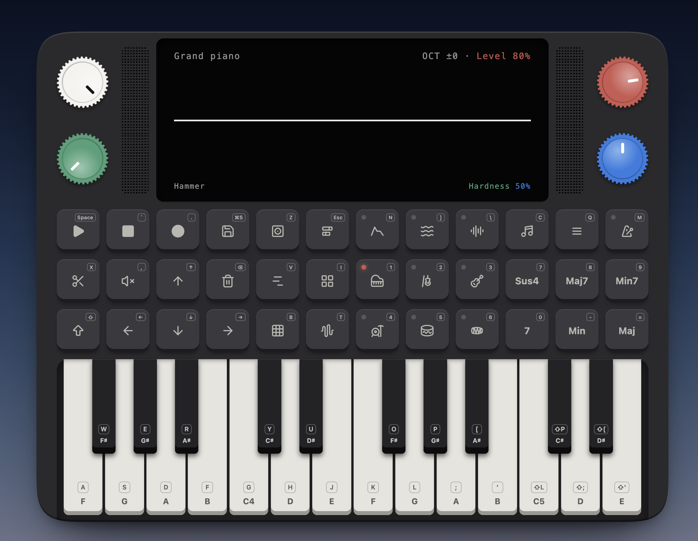

> source available. all rights reserved.  
> AI was used and paid for.  
> no copyright infringement intended.

# Studio

Studio is a browser-based instrument. The home page hosts **The Device**: an all-in-one virtual synthesizer, a compact music box with its own sound engine, chord machine, drum machine and piano roll, played from the keyboard and recorded onto multitrack tapes.

## Docs

These docs, and this README, are also served in the app at `/docs` (`web-react/app/routes/docs.tsx`, and in web-rust its `build.rs`). The route reads every markdown file under `docs/` at build time and lists it in its sidebar. Each doc opens with a TOML config between two `---` lines giving its place in its folder (`order = 2`), and each folder has a `_meta.toml` giving its own `order` and the `title` the sidebar shows. A screenshot can have a dark twin beside it, `name.dark.webp` next to `name.webp`, which the route shows in the dark theme.

### [The Device](docs/the-device/overview.md)

The reference: where everything is on the Device and what it does. A numbered [overview](docs/the-device/overview.md) of the whole box with the knobs' jobs in each kind of view, the [screen and views](docs/the-device/screen-and-views.md) from the screen's layout to a picture of every view, the [pads and keybed](docs/the-device/pads-and-keybed.md): all 36 pads with their keys and Shift jobs, and the keys with their letters, and [MIDI](docs/the-device/midi.md): a MIDI keyboard or controller playing the Device, set up in the panel beside the light/dark switch, its keys on the keybed with their velocity and sustain pedal, and its knobs and pads mapped to the Device's by moving them, or, on an OP-1, mapped from the start.

### [Guides](docs/guides/introduction.md)

A picture-by-picture walk through the Device, from the first note to a finished song. [Play notes and chords](docs/guides/play-notes-and-chords.md): a key plays a note, a chord pad turns it into several, the play style sets how they come out, and a progression strings chords together. [Shape the sound](docs/guides/shape-the-sound.md): pick an instrument, change how it's made on the Synth screen, and add the ADSR, LFO and FX. [Set the tempo](docs/guides/set-the-tempo.md): the BPM, tap tempo, the click, and swing for the tape and each track. [Make a song](docs/guides/make-a-song.md): build Starter 1, the first of the two tapes the Device comes with, step by step: the Suspended progression in D, folk-strummed on the oscillator's sine three times round, a New jack swing beat from bar 3 to a bar past the chords, and the strum again over the middle round on the oscillator with a saw added under the sine. Then manage the tracks: repeats, copies with gaps, mute and solo, a track's own tempo and instrument, clip and delete, and your own playing recorded in. Then [undo and start over](docs/guides/undo-and-start-over.md).

### Synth

How the Device makes its sound.

- [Sound pipeline](docs/synth/sound-pipeline.md): how a note gets from a key press to the speakers: the `AudioWorkletProcessor` on the audio thread, the sample-accurate render loop, the signal flow from voice to bus to master, the FDN reverb and the limiters.
- [Voices and modules](docs/synth/voices-and-modules.md): the voice lifecycle and stealing, and the filter and vibrato every voice carries.
- [Master effects](docs/synth/master-effects.md): the engine's own effects over every instrument, as the Device's ADSR, LFO and FX views set them: the master ADSR on every voice, the LFO (pitch, volume, filter or pan) and the FX chain (drive, chorus, ping-pong delay) over the dry mix, and the dry metronome.
- [Parameters and calibration](docs/synth/parameters-and-calibration.md): the `ParamSpec`s every instrument publishes, how knobs map and when changes apply, tuning and loudness calibration, the diagnostics and the Lab, and adding a patch or a Device preset.
- [Physical modeling](docs/synth/physical-modeling/overview.md): how the Device's instruments are modelled, with diagrams and screenshots of its own Synth screen (in `web-react/public/docs/synth-engine/`). Every note is an exciter driving a resonator through a body. An overview of that idea and the bodies, then a doc per family: [strings](docs/synth/physical-modeling/strings.md), [blown](docs/synth/physical-modeling/blown.md), [bowed](docs/synth/physical-modeling/bowed.md), [drums](docs/synth/physical-modeling/drums.md), [free reeds](docs/synth/physical-modeling/free-reeds.md), [tuned percussion](docs/synth/physical-modeling/tuned-percussion.md) and the [oscillator](docs/synth/physical-modeling/oscillator.md).

### Library

The music behind the Device's pickers.

- [Chord progressions](docs/library/chord-progressions.md): the source material behind the Device's chord progressions (Shift + Piano roll), compiled from David Bennett's videos: 30 from his chord progressions playlist and 20 from elsewhere on his channel. Each entry links its video and gives the progression in Roman numerals, songs that use it and a short note on why it works, credited to him throughout. The playlist's other 21 videos are listed at the end.
- [Drum beats](docs/library/drum-beats.md): the 84 grooves behind the Device's drum beats (Shift + Drum grid), in ten styles from simple kick-and-hat starters through rock, funk, jazz, Latin, hip hop and electronic to classical and the tabla's taals. Each gives its kit, tempo and meter, the pattern as the drum grid plays it, what makes it feel the way it does, and the records and drummers to hear it from, from Hal Blaine's "Be My Baby" to the Amen break and Ravel's _Boléro_.

### Development

Working on Studio: setting it up, its stories, the rules agents follow and the Device's design rules.

- [Installation](docs/development/installation.md): install with `npm install`, then run the app on port `5173` and Storybook on `6006`. Build either one for production. Run the checks (typecheck, the DSP and engine unit tests, the headless story smoke tests, lint and format), and clean out build artifacts and dependencies when you want a fresh start.
- [Storybook](docs/development/storybook.md): how the component stories are organized: `Design System`, `Home`, `Page`, `Docs` and `Lab` titles, colocated with their components, each linked to its page in the app's `/storybook`. It also covers the conventions every story follows: a `Default` story bound to props, `autodocs`, a one-line description, the `withDevice` and `withDocs` decorators, and light and dark coverage through the theme addon.
- [Agent guidelines](docs/development/agent-guidelines.md): the rules for AI agents working in this repo. Stories start with a `Default` and add only focused variants. Styling is Tailwind only, with `tv` for variants and types instead of interfaces. Scratch and restating comments are stripped before handing work back, and no interaction tests are written without asking first.
- [Design rules](docs/development/design-rules.md): the rules the Device's look and controls keep to: fixed native size, two spacing tokens, theme colours that cross-fade, and hotkeys that never overlap.
- [Monorepo plan](docs/development/monorepo.md): Studio splitting into four sibling folders with no monorepo tooling beyond one Cargo workspace for the Rust crates: `web-react` (this React app, moved), `web-rust` (the Device in Rust, a Trunk wasm app with a [fluid](https://github.com/nrayamajhee/fluid) UI), `sound-engine` (the latency-critical audio in Rust: an AudioWorklet for the models, wrapped Web Audio nodes for the rest) and `editor` (an axum backend on PostgreSQL through sqlx). The first steps are in: the React app moved to `web-react`, [`web-rust`](web-rust/README.md), the whole Device, looking and playing as web-react's does, and [`sound-engine`](sound-engine/README.md), web-react's physical models ported to Rust and run in an AudioWorklet, which web-rust plays through.
- [Porting the Device to Rust](docs/development/web-rust-port.md): the record of the port, now complete. It covers how its parity with web-react was checked (fixtures from web-react's own code, the same steps played side by side, screenshots diffed in both themes), what the first step's audit found and what came of it, the architecture the port follows (stores per provider, a mode per view binding the knobs, pads and screen, data exported from web-react's tables), and the steps it landed in. It ends with what [fluid](https://github.com/nrayamajhee/fluid) could do better and the one thing in it that bit the port.

## Credits

The Device's chord progressions are based on the chord progression analyses by **David Bennett** of [David Bennett Music Theory](https://www.youtube.com/channel/UCz2iUx-Imr6HgDC3zAFpjOw), compiled from his [chord progressions playlist](https://www.youtube.com/playlist?list=PLlx2eo2tD6KpfGmE-MXwcIRQh21neAKsK) and other videos on his channel. All credit for the analyses, their names and the song examples goes to him; watch his videos for the full explanations.
