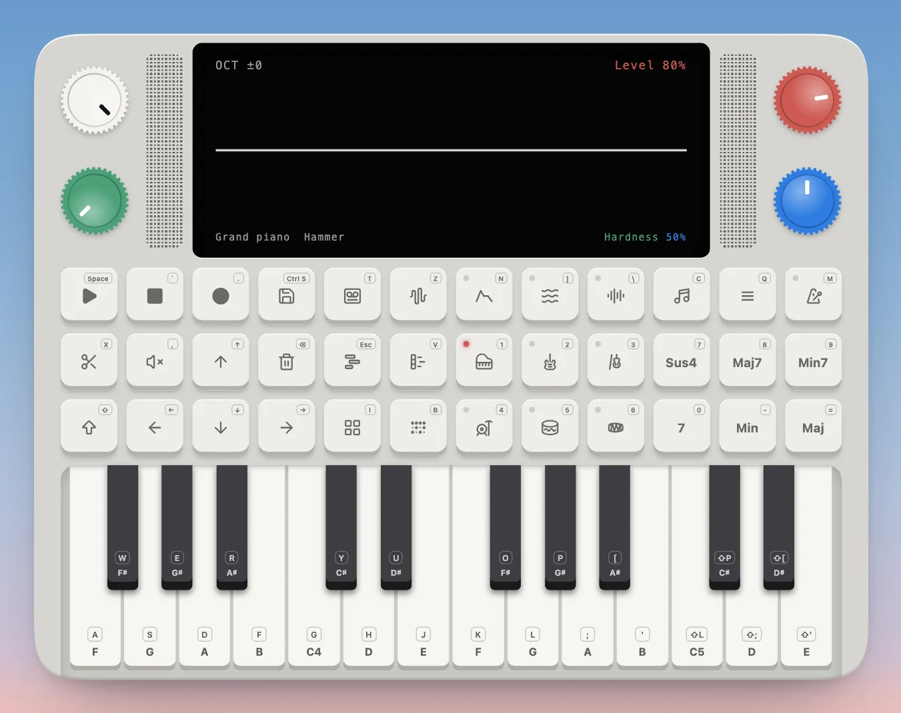

---
order = 1
---

# Guides

The Device is an all-in-one virtual synthesizer: a small, self-contained music box with its own sound engine, chord machine, drum machine, piano roll and multitrack tapes, played straight from your keyboard or mouse. These guides walk you through it from the first note to a finished song. For where every control sits and what it does in each view, see [The Device](../the-device/overview.md).

Every picture in the guides is the Device as you'll see it. An orange ring marks the control the step presses. Each control also has a keyboard shortcut, printed in the small badge on its corner (Space for Play, `I` for Instruments, and so on), so you can play the whole Device from your computer keyboard.

1. [Play notes and chords](play-notes-and-chords.md): the keys and octaves, chord pads that play several notes from one key, play styles that set how those notes come out, and progressions that string chords together.
2. [Shape the sound](shape-the-sound.md): pick an instrument, change how it's made on the synth parameters and save it, and add the ADSR, LFO and FX over everything you play.
3. [Set the tempo](set-the-tempo.md): the BPM, tap tempo, the click and swing.
4. [Make a song](make-a-song.md): a chord progression on the piano roll, a beat in the drum grid, arranging the tracks, and a new tape with your own playing.
5. [Undo and start over](undo-and-start-over.md): Revert, and where your work is kept.
