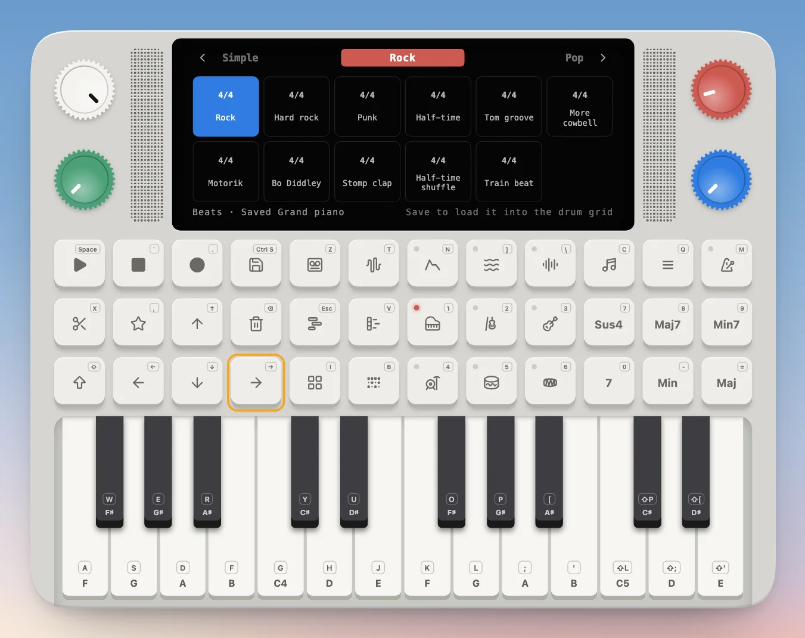
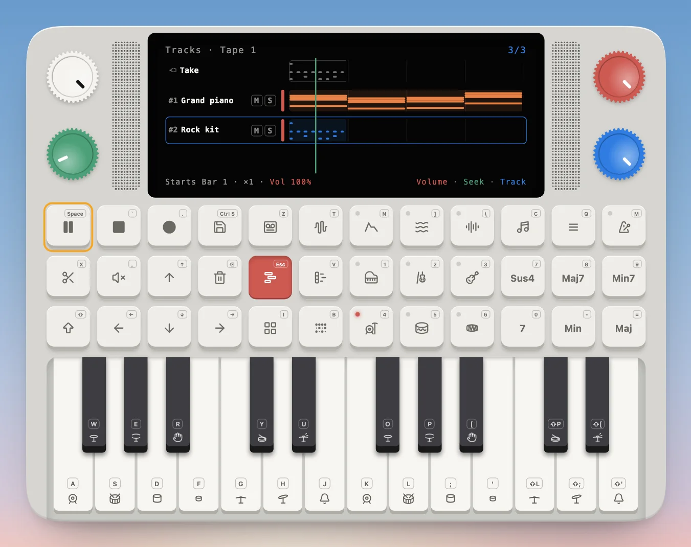
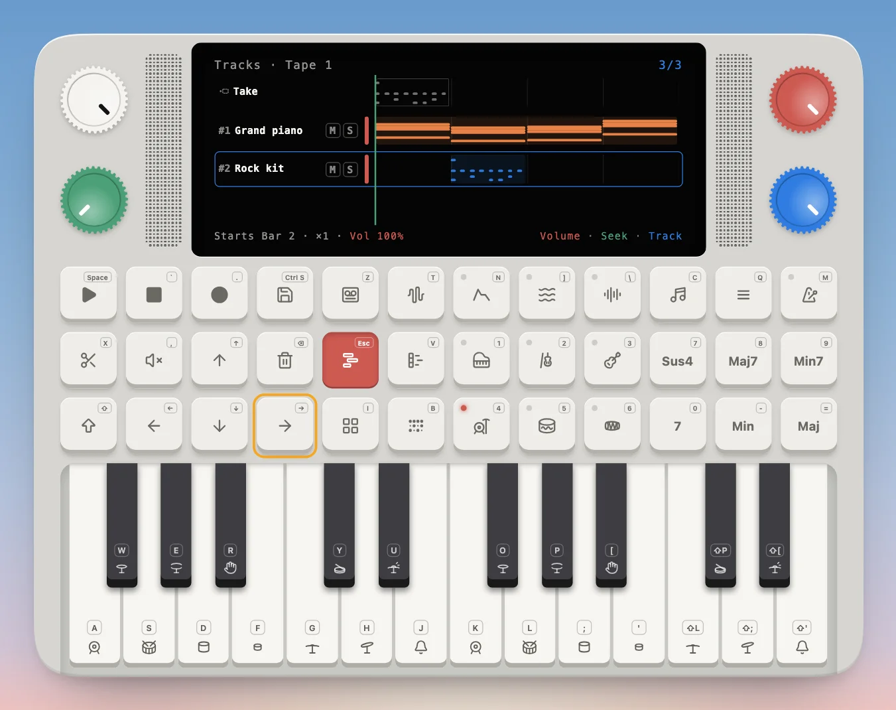

---
order = 5
---

# Make a song

A song on the Device is a **tape**: a stack of **tracks** played together. You make each track as a **take**: a chord progression in the piano roll, a beat in the drum grid, or your own playing. Save turns the take into a track, the **Tracks** view arranges them, and **Tapes** keeps every tape you've made.

## Chords on the piano roll

The quickest way to a song starts from a chord progression. The Device knows dozens, from the four-chord Axis to the Andalusian cadence, each with songs that use it (see [Chord progressions](../library/chord-progressions.md)).

**1. Open the progressions.** Hold **Shift** and press the **Piano roll** pad (`Shift V`).

The red knob turns the pages (pop, major, minor, modal, blues and rock, jazz, cadences and more) and the blue knob picks a progression. Tap a tile, or press Play, to hear it in your play style and tempo; press Play again to pause.

**2. Save it.** Press **Save**. The screen asks for the **home note**: the key your song is in.

**3. Play the home note.** Press a key (here `G`, middle C). The progression becomes the **take**, a chord a bar, and the **piano roll** opens to show it: one row per note, time running left to right.

Press **Play** to hear the take, and Stop (`` ` ``) when you're done. Want another sound? Switch instruments now and the take plays on it.

**4. Keep it as a track.** Press **Save** in the piano roll. The take becomes track 1 of the tape, and the **Tracks** view opens with it.

## A beat in the drum grid

Drums work the same way, from a library of [drum beats](../library/drum-beats.md).

**1. Open the beats.** Hold **Shift** and press the **Drum grid** pad (`Shift B`).

The red knob turns the styles (simple, rock, pop, funk and soul, jazz, Latin and reggae, hip hop, electronic, classical and South Asian) and the blue knob picks a beat. Tap a tile, or Play, to hear it on its own kit.

**2. Save it.** Press **Save**: the beat loads into the **drum grid** on its kit, at the Device's tempo.

In the drum grid, Play loops the pattern. Stopped, the green knob moves the head and the keys set or clear a drum there; the red knob sets the length and the blue one the resolution. Record loops the pattern and lands what you tap on the nearest step.

**3. Keep it as a track.** Press **Save** again. The pattern becomes the next track.

## Arrange the tracks

**Tracks** (`Esc`) is the open tape: one lane per track, with the **Take** on top for whatever you're working on. Press Play to hear them all together.

**Pick a track** with the blue knob or ↑ ↓. The screen's top right counts them, and the footer tells you where the picked one starts, how often it repeats and how loud it is.

| To                      | Press                                                   |
| ----------------------- | ------------------------------------------------------- |
| Play or pause the tape  | Play (Space); Stop rewinds                              |
| Move through the tape   | the green knob                                          |
| Set a track's volume    | the red knob                                            |
| Slide a track by a bar  | ← or →                                                  |
| Repeat a track          | Shift + → (and Shift + ← for fewer)                     |
| Play it again later on  | Shift + ↓ adds a copy; Shift + ↑ ↓ pick between copies  |
| Mute a track            | Mute (`,`); its `M` lights                              |
| Solo a track            | Shift + Mute; its `S` lights                            |
| Loop part of a track    | Clip (`X`), then Shift + the red and blue knobs to trim |
| Cut a track to its clip | Shift + Clip                                            |
| Delete a track          | Delete (Backspace), twice                               |
| Save the tape as audio  | Save: a FLAC of the mix                                 |
| Save the tape as MIDI   | Shift + Save                                            |

**Copies** play a whole track again further along the same lane, so a part can drop out and come back: a piano that plays four times, rests for a few bars, then plays twice more. Shift + ↓ adds a copy right after the last, which → then slides along to leave a gap; Shift + ↓ and ↑ step to the next and previous copy, and the arrows, Shift + → and Delete work on the picked one, outlined in blue. A copy never slides back over the one before it, and one that grows pushes the later ones along. The row's right edge counts them: ×2, ×3.

**Clip** loops a section of a track instead of playing it whole; the section is outlined in red. Hold Shift and the knobs change job: red and blue move the clip's start and end, and green slides the track by beats. Shift + Clip cuts the track down to its clip for good.

**Delete** asks first: press it once and the screen asks you to press again.

## Start a new tape

Your tapes live in **Tapes** (`T`), one tile a tape, each with its own tracks, tempo and time signature.

- Press **Save** for a **new tape**, at the tempo you're playing now.
- The green knob or ← → opens another tape; Play plays it.
- Double-click a tape to open its tracks. Delete removes the open tape, after asking.

The new tape starts empty, with only the take.

**Record your own playing.** Pick a sound (here the Picked guitar, `3`) and open the **Piano roll** (`V`). Press **Record** (`.`) to arm it, then **Play** to start: what you play becomes the take, in time with the click if the metronome is on.

Press Record again to stop. Stopped, the green knob scrolls through the take, the blue knob moves the roll's octave and ↑ ↓ move it a semitone.

Press **Save** to keep it as a track, and carry on: a progression, a beat, more takes, until the song is done. Then press Save in Tapes for the next one.

