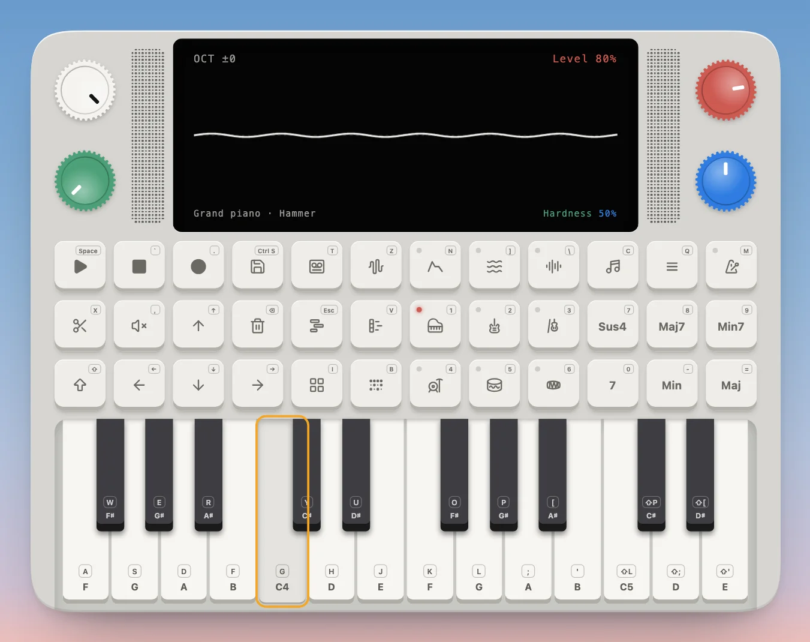
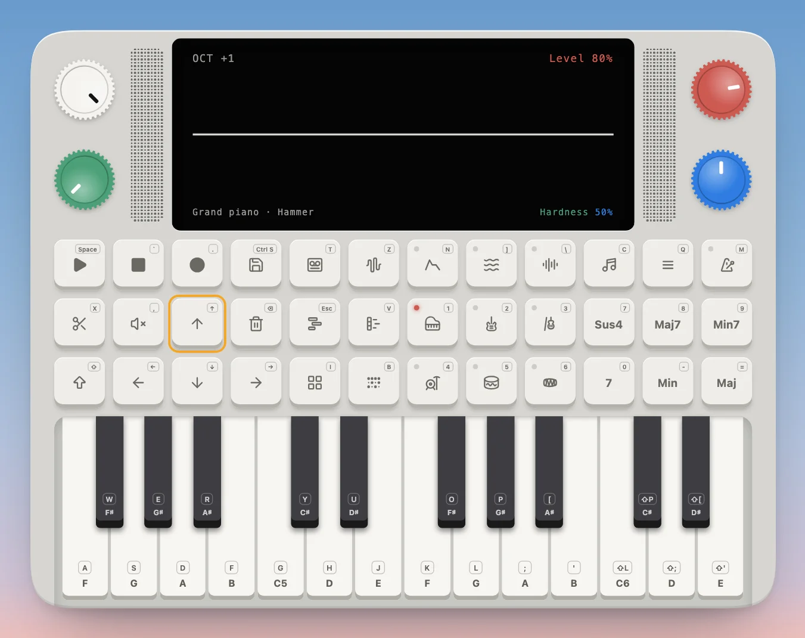
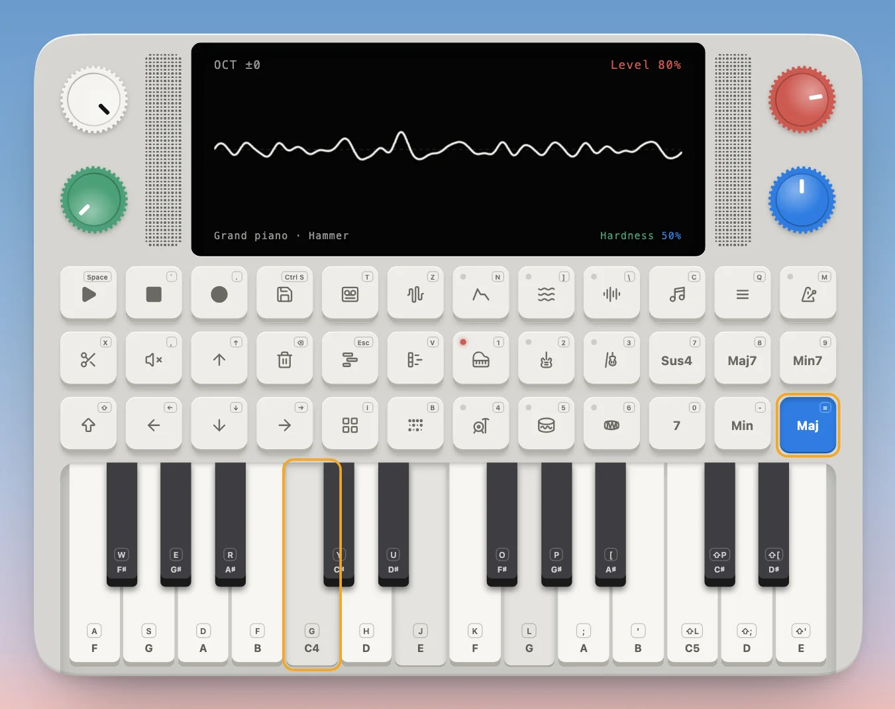
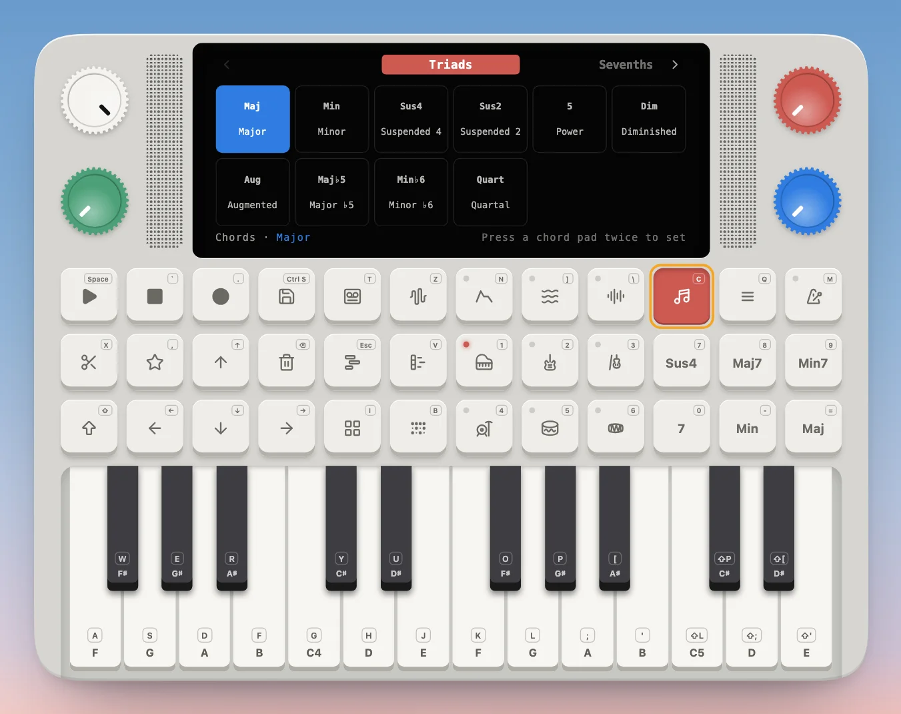
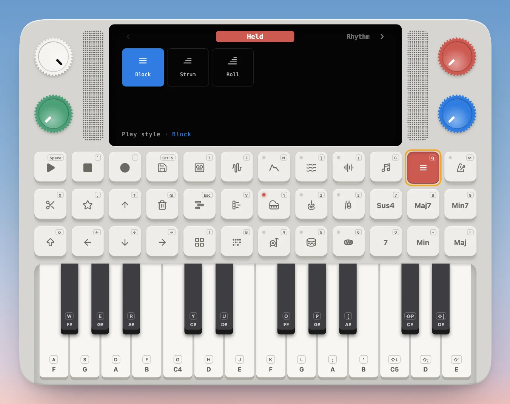
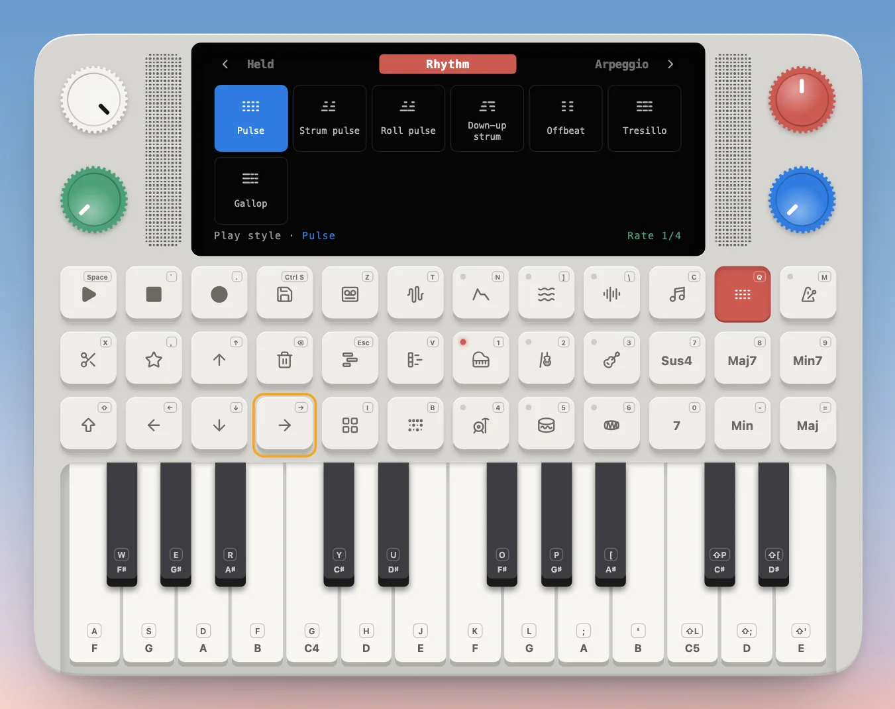
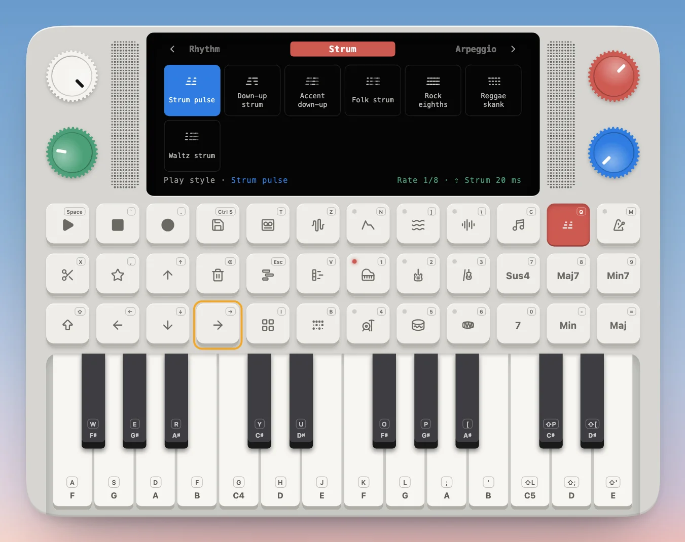

---
order = 2
---

# Play notes and chords

Everything the Device plays is built from notes. A key plays one note, a chord pad turns that key into a chord of several notes, the play style sets how those notes come out, and a chord progression strings chords together. Each one is the last, played many at a time.

## Play a note

Click a key, or press its letter: the home row `A S D F G H J K L ; '` plays the white keys and the row above plays the black ones, like a DAW's musical typing. `G` is middle C. The screen shows the sound's wave while it plays, and the instrument's name along the bottom.

The very first press also wakes up the audio, which browsers only allow after you touch the page, so it may sound a moment late.

- **Higher or lower.** ↑ and ↓ (or ← and →) move the keybed an octave. The screen's top left shows how far, `OCT +1`.
- **Louder or quieter.** The white knob is the volume. The red knob is the synth's level going into the mix.
- **Shape the sound right here.** On the main screen the green knob picks a setting and the blue knob changes it. The footer names it, `Hardness 50%`.

## Play a chord

A chord is several notes sounding together, and the Device plays one from a single key. The six pads on the right (`7`–`=`) are **chord pads**: Sus4, Maj7, Min7, 7, Min and Maj. Click one to latch it, or hold its key, and every key you play becomes that chord, built up from the key: press C with Maj latched and you hear C, E and G. Click the pad again to let it go.

**Change a chord pad.** Open **Chords** (`C`). The red knob turns the pages (triads, sevenths, and more), the blue knob picks a chord, and pressing a chord pad twice puts it there.

## Choose how a chord plays

A chord's notes don't have to start together. **Play style** (`Q`) sets how they come out: all at once (Block), strummed low to high, rolled, spread into a rhythm (pulses, a tresillo, a gallop), strummed like a guitar (down-up, folk, rock eighths, a reggae skank, a waltz) or broken into an arpeggio. The accented rhythms and strums lean a touch harder on some strikes and ease off the upstrokes, and the piano roll keeps how hard each one was. The chord stays the same; only the timing and weight of its notes change. Where a style has a rate or a strum gap, the green knob sets it, and Save keeps your version as a new style. Your favorites come first, and Mute stars or unstars the picked style; they start out empty. **Nishan's Picks** come next: Block, Pulse, Accent pulse, Accent down-up, Folk strum and the Up-down and Alberti arpeggios.

## From chords to progressions

A chord saves you playing its notes one by one; a **chord progression** does the same for chords. It's a short run of them, a chord a bar, like the four-chord Axis (I V vi IV) that carries hundreds of pop songs. The Device knows dozens, and loads one as the take, in your key, with a single Save, each chord played in your play style. That's where [making a song](make-a-song.md) starts.
