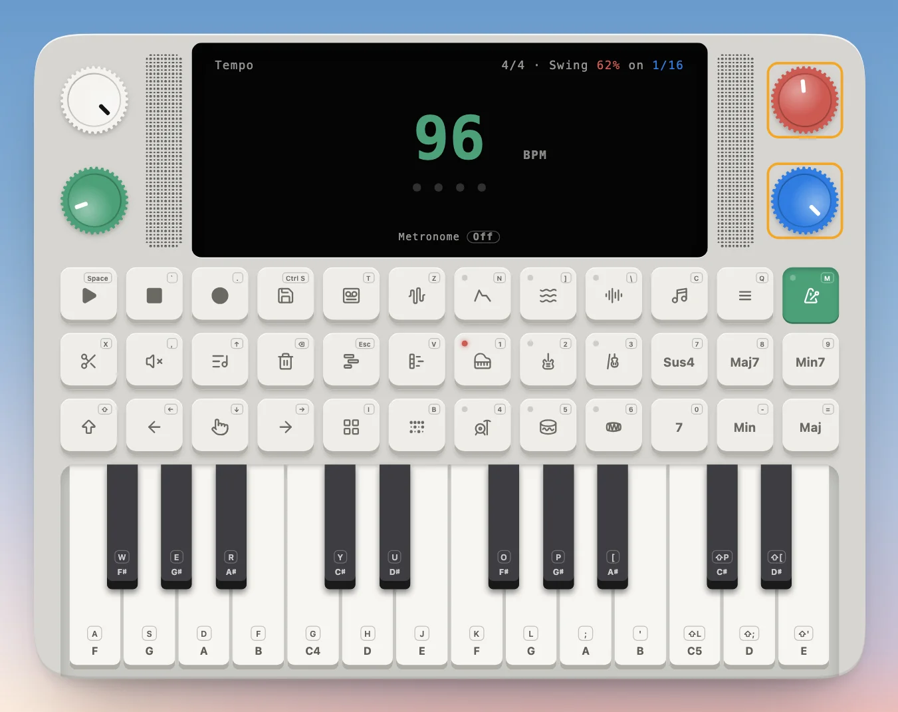

---
order = 4
---

# Set the tempo

**Tempo** (the metronome pad, `M`) shows the beats per minute. Turn the green knob or press ← →, drag the number, or click it to type one. Press ↓ to **tap** the tempo in on the keys. **Shift + Tempo** starts or stops the click.

This is the tape's tempo, and each tape keeps its own: the take records at it, the click and the drum grid keep to it, and the tracks' bar lines are drawn at it.

**Every track keeps a tempo of its own**, the one it was playing at when you saved it, so a part recorded at 96 BPM stays at 96 when you move the tape to 120. To change a track's tempo, pick it on the tracks and open Tempo: the title names the track, and the knob, ← → and the number now set its tempo. **↑ links it to the tape's tempo** instead, so it speeds up and slows down with the tape; ↑ again gives it back a tempo of its own, at the speed it plays now. A track stays on its bar when the tape's tempo changes, but at a different tempo from the tape its bars no longer line up with the tape's.

With no track picked (the take's row), **↑ sets every track to the tape's tempo**. Each one gets the tape's BPM as its own, once: they all play at the tape's speed now, but stay there if the tape's tempo changes later.

## Swing

**Swing** pushes every second eighth or sixteenth late: the lilt of a shuffle, a jazz ride or a lo-fi beat. In Tempo, the **red knob** sets how much. At 50% it's straight; at 66% the first of each pair takes two thirds of the time, a triplet feel; 75% is a hard shuffle. The **blue knob** picks what it swings, eighths or sixteenths. The top line shows both in the colours of their knobs, as the BPM is in green.

The tape's swing bends everything that plays on it: the take as it plays back, the drum grid's pattern, the previews, and chords held in a play style, whose steps swing from when you press the key. It bends time rather than moving notes. A take you record with swing is kept straight and played back swung, so it sounds as you played it, and changing the swing later changes how everything already there swings. A beat on a triplet grid (New jack swing, Lo-fi, the shuffles and the jazz beats) is swung already by where its steps fall, and plays straight.

**Each track keeps its own swing**, the tape's when you saved it, so changing the tape's swing later leaves it be. Pick a track and open Tempo to change it: the red and blue knobs then set the track's. Revert's Tempo puts the tape back to straight.
