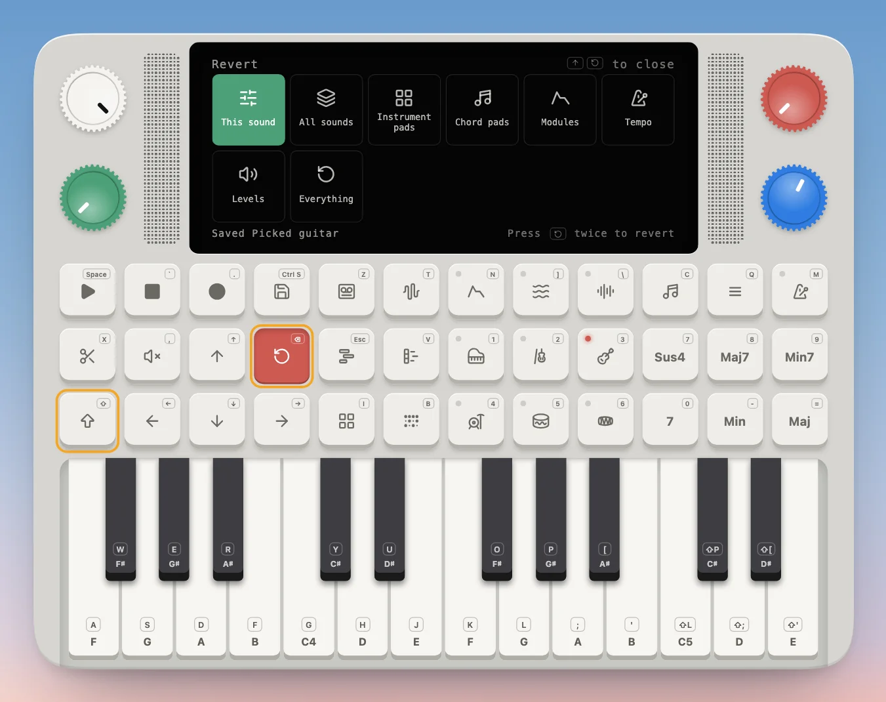

---
order = 6
---

# Undo and start over

**Revert** (Shift + Delete, on the main screen) puts things back: this sound's edits, all sounds, the instrument or chord pads as they came, the modules, the tempo, the levels, or everything (which starts the whole Device over). The green knob picks one, and Delete twice reverts it. Any other pad closes Revert.

Everything you make (tapes, tracks, saved sounds, pads and play styles) is kept in your browser, so it's there next time you open the page.
