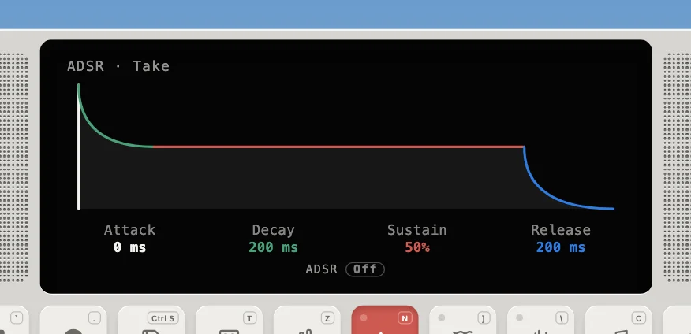
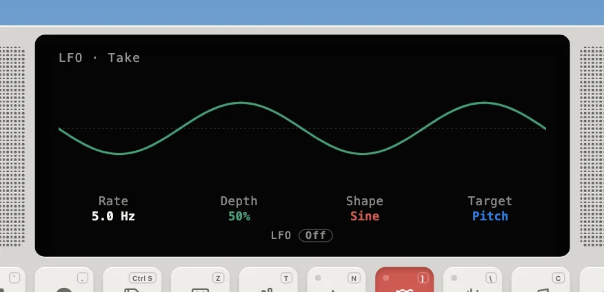
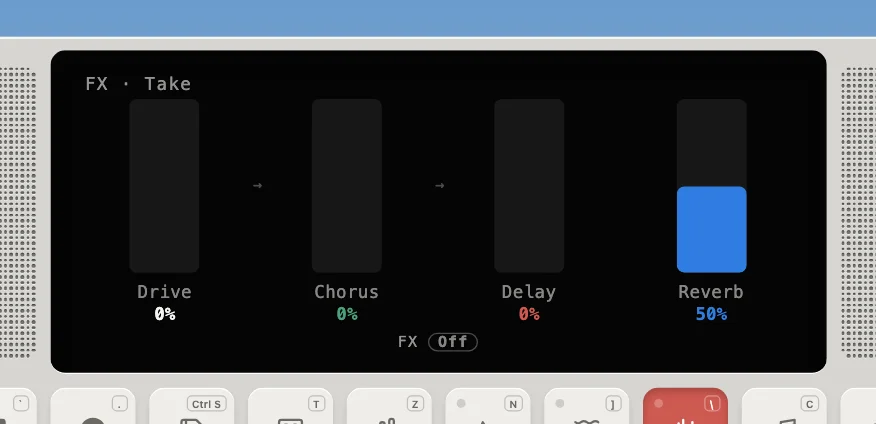

---
order = 3
---

# Master effects

The engine's own effects, apart from any instrument's: an **ADSR** on every voice, and over the whole dry mix an **LFO** and an **FX** chain. The Device sets them over every instrument from its ADSR, LFO and FX views, and keeps them per track. Each has its own params (`adsr.*`, `lfo.*`, `fx.*`) and is transparent at its defaults, so with all three off every instrument sounds as modelled. Where they sit in the engine is in [Signal flow](sound-pipeline.md#signal-flow).

## ADSR

Every voice is multiplied by one shared amplitude envelope (the `adsr.*` master params, set from the Device's ADSR mode) on top of its model's own envelopes. It triggers when a note or hit starts and releases when the key (or sustain pedal) lets go. The engine's defaults, instant attack, 100% sustain and a 4 s release, leave notes as modelled; the Device sends those when its ADSR is off, and its knob values (0, 200 ms, 50%, 200 ms to start) when it's on. Because it's a volume envelope, a short release can cut a tail, but a long one can't make a damped string ring longer.

## LFO

One modulator over the whole dry mix (`engine/MasterLfo.ts`, the `lfo.*` master params), so every model responds the same way. Shapes: sine, triangle, square, a rising saw, random (a new value each cycle); the square's and random's edges and the saw's drop are eased over 5 ms so they don't click. Targets:

| Target | What it moves                                                                                             |
| ------ | --------------------------------------------------------------------------------------------------------- |
| Pitch  | a delay line swept around its centre: up to ±3% (about ±50 cents) at full depth, crossfaded in over 20 ms |
| Volume | gain = 1 − depth × (1 − lfo) / 2, so full depth dips to silence                                           |
| Filter | a lowpass swept from 250 Hz to 16 kHz, blended in by depth                                                |
| Pan    | equal-power, centred at rest, hard left and right at full depth                                           |

## FX

Three stages in series over the dry mix (`engine/MasterFx.ts`, the `fx.*` master params):

| Stage  | What it does                                                                                                                                                     |
| ------ | ---------------------------------------------------------------------------------------------------------------------------------------------------------------- |
| Drive  | the bus drive curve, `softClip(x × (1 + 9d)) / (1 + 2d)`, then a DC blocker                                                                                      |
| Chorus | two taps swept in quadrature around 15 ms (±4 ms at 0.8 Hz): left and right drift apart, widening the image                                                      |
| Delay  | ping-pong: the mono sum enters on the left, each repeat crosses sides every 250 ms (an eighth note at 120 BPM), 0.45 feedback, 3.5 kHz damping so repeats darken |

A stage at zero is skipped, and the chorus and delay clear their lines when they switch off, so an old tail never replays. The Device's FX module also has a Reverb knob; it sets `reverb.return`, the level of the engine's shared [reverb](sound-pipeline.md#reverb-dspfdnts). The reverb is fed by the instruments' sends, not by the FX, so echoes don't pile into it.

## The metronome stays dry

The metronome's woodblock is added after the LFO and FX, so tremolo or echoes never blur the click.
