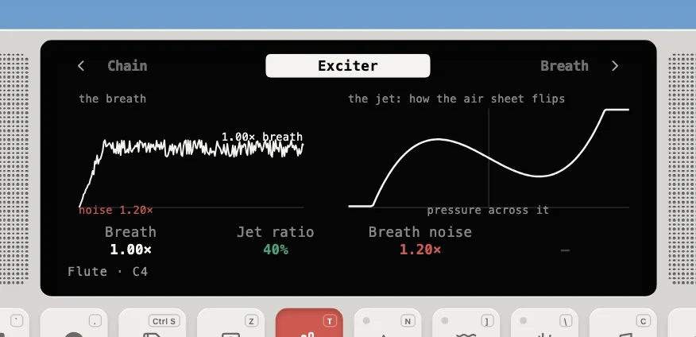

---
order = 3
---

# Blown

The flute, alto sax, clarinet, trumpet, bass trumpet and trombone are ported from STK (`models/BoreInstrument.ts`).

A wind instrument is a nonlinear "mouth" coupled to a tube. Pressure waves travel down the tube, reflect off the open end or bell, and come back to disturb the jet or reed. That disturbance is what keeps the note going.


|            | Flute (STK `Flute`)                                                       | Sax (STK `Saxofony`)                                             | Brass (STK `Brass`)                                                          |
| ---------- | ------------------------------------------------------------------------- | ---------------------------------------------------------------- | ---------------------------------------------------------------------------- |
| Mouth      | air jet: its own delay (Jet ratio × tube) then `x(x² − 1)`, clamped       | reed table `0.7 + slope·x`, slope = 0.1 + 0.4 × Reed stiffness   | lips: a resonance at the note; its output squared and clipped is the opening |
| Tube       | tuned to 2/3 of the note, so the jet overblows it into the right register | split into reed-side and bell-side sections at the Blow position | two periods long, so the lips lock onto its second mode                      |
| Reflection | one-pole lowpass, inverted, DC-blocked                                    | −0.95 × lowpass with cutoff **14 × f0** (min 500 Hz)             | 0.85 back at the lips, DC-blocked                                            |

Each mouth is drawn on its Exciter page; the flute's shows the breath with its noise, beside the jet's `x(x² − 1)` curve:



The sax's bell lowpass tracks the note, as a real sax's open tone holes move its reflection; STK's fixed 740 Hz makes low notes overblow and high ones fail to speak.

The lips' Q and gain are fixed relative to the note, where STK's fixed resonance holds low notes' lips open:

```text
   r = 1 - 0.026 w          gain = 2.26 w^2          (w = 2 pi f_lip / fs)
```

This matches STK at 880 Hz and behaves the same at every pitch, so both trumpets speak from E2 to C6. Lip tension moves the resonance ±0.05 octave, brightening and bending the note as tightening real lips does. The **trombone** is the same lip loop with a larger, darker bell (presence near 600 Hz) and a long portamento for the slide.

The **clarinet** (STK `Clarinet`) is a reed on a cylinder: one delay line, the reed table `0.7 − slope·x` on the difference between the reflected wave and the breath, and an end reflection of −0.95 through a two-point average. The inverting reflection makes the loop two passes of the bore, so its delay is half the period, less the average's half sample and the loop's sample; a tube closed at one end like this sounds mostly odd harmonics.

## Shared behavior

- **Monophonic, last-note priority.** Holding a note and pressing another retunes the tube without a new attack (**legato**), and the delay lengths glide (**portamento**). Releasing returns to the previous held note. In a chord burst, only the first note plays.

- **Velocity → breath.** Velocity sets the steady pressure between the patch's `pressure: [low, high]`, scaled by the Breath knob.
- **Watchdog.** If the loop ever blows up (|out| > 4, or NaN), it is cleared and a warning is posted once.
- **Measured tuning.** A nonlinear loop settles slightly off the pitch its delay implies. Each patch carries a `tuningCents` table measured at 44.1 and 48 kHz, and the engine picks the closest rate.
