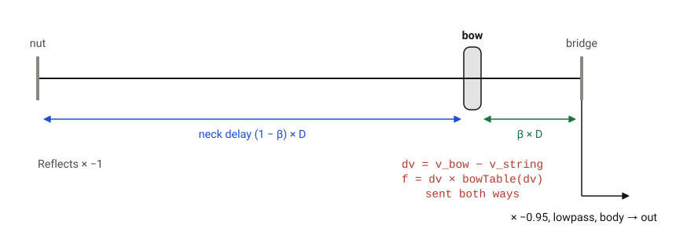
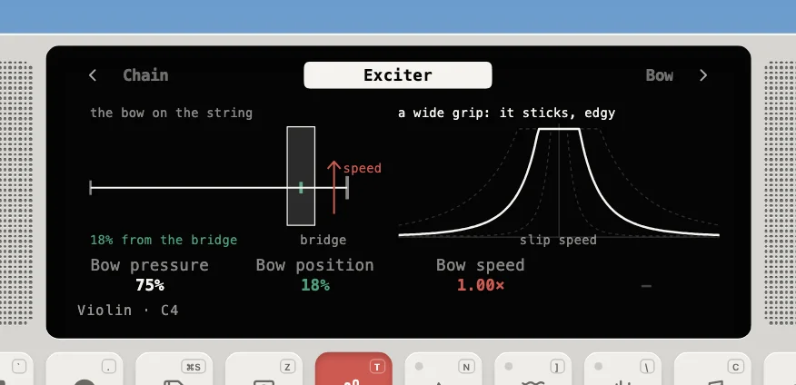

---
order = 4
---

# Bowed

The violin and cello are STK's `Bowed` (`models/BowedInstrument.ts`).

The bow sits on the string, splitting it into a neck side and a bridge side. At every sample the bow compares its own velocity with the string's velocity under it. The friction curve decides whether the string **sticks** to the bow or **slips** free, and that stick-slip cycle is the sawtooth-like motion a bowed string makes.



```text
   bowTable(x) = (|slope x (x + 0.001)| + 0.75)^-4, clamped to [0.01, 0.98]
   slope = 5 - 4 x Bow pressure            beta = Bow position
   v_bow = (0.03 + 0.2 x velocity) x Bow speed x ADSR
```

The Exciter page draws the bow on the string and the friction curve: where the slip speed is small the bow grips (sticks), and Bow pressure sets how wide that grip is.



- Up to 4 voices (double stops and chords). Vibrato is the [vibrato module](../voices-and-modules.md#modules) on the neck's length, 10 cents after a 0.3 s Delay, fading in over 0.4 s, the way a player adds it late; its Level sways the bow.
- **Portamento**: a note played while another is still held starts at that note's loop length and glides to its own (80 ms on the violin, 100 ms on the cello), like a finger sliding along the string. Notes starting within 30 ms of each other are a chord and don't glide. The plucked and struck strings have no portamento: a fret or hammer jumps.
- The violin's body filter (Maestre's) was designed at 44.1 kHz. Its pole/zero pairs are rescaled to the actual sample rate so the resonances stay put.
- The **cello** runs the same loop an octave and a fifth lower. The violin's filter would put its resonances in the wrong place, so the cello uses the bus's modal body instead (air and wood modes near 100 and 200 Hz); its Body knob is that body's mix.
