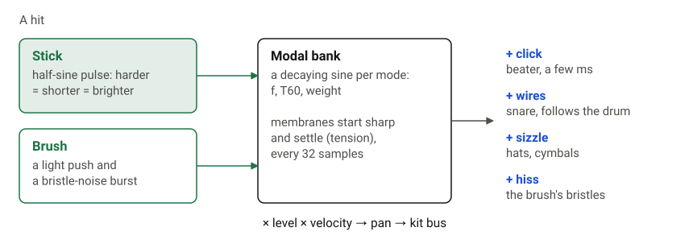
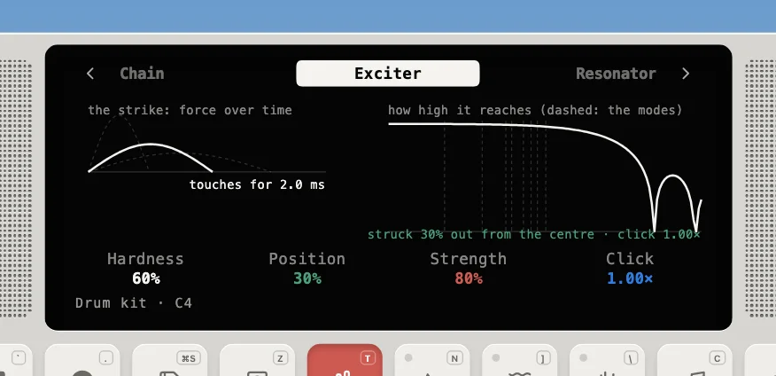
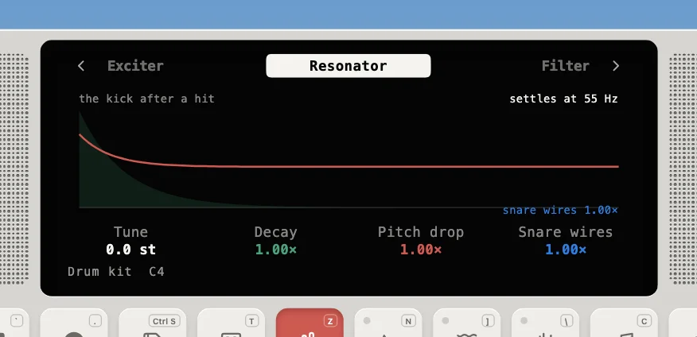

---
order = 5
---

# Drums

The Drum Kit, Rock Kit, Jazz Kit, 808 Kit, 909 Kit, madal and tabla (`models/DrumKit.ts`) use **modal synthesis**: the resonator is a bank of decaying sine waves, one per vibration mode. Each mode is a two-pole resonator:

```text
   y[n] = g x[n] + 2r cos(theta) y[n-1] - r^2 y[n-2]

   theta = 2 pi f / fs              (mode frequency)
   r     = exp(-ln(1000) / (T60 fs)) (mode decay)
   g     = amp x sin(theta)          (impulse response peaks at ~amp)
```







| Piece model                                                   | How it's built                                                                                                                                                                                                                                                                                          |
| ------------------------------------------------------------- | ------------------------------------------------------------------------------------------------------------------------------------------------------------------------------------------------------------------------------------------------------------------------------------------------------- |
| **membrane** (kick, snare, toms)                              | Ideal circular-membrane ratios 1, 1.593, 2.136, 2.295, 2.653, …. **Position** blends center hits (only the symmetric modes) toward edge hits (all modes). Optional shell mode.                                                                                                                          |
| **metal** (hats, cowbell, crash, ride, ride bell, side stick) | Either a table of modes or a seeded log-spread set: `T60_i = T60 (f_lo / f_i)^0.3`, amplitude `1/sqrt(i+1)` ± 30 %. A closed hat **chokes** the open hat (30 ms).                                                                                                                                       |
| **noise** (clap, tambourine, brush sweep)                     | Several short noise bursts a few ms apart (slightly jittered), then a decaying tail, all through a bandpass. The sweep has no bursts: its tail swells in from silence (a raised cosine) before it decays, as a brush stirred across the head does.                                                      |
| **loaded** (madal, tabla)                                     | A head loaded with paste (syahi, kharee) has near-harmonic modes, so each stroke lists its own partials (ratio, T60, amp). Open strokes ring (Tun, Ta), rim strokes damp the fundamental (Na, Tin), closed strokes are short slaps (Te, Ke, Ti, Ka), and Ge settles in pitch as the bayan head relaxes. |
| **combo** (Dha, Dhin)                                         | Strokes played together (Dha = Na + Ge), scaled to peak like a single stroke.                                                                                                                                                                                                                           |

**Brushes** (the Jazz Kit) replace the stick on the membranes and metals: the stick pulse lands at about a third of its weight, and the wires add a noise burst that rises in 1.5 ms and dies away over the piece's brush length (shorter on a harder stroke). The burst is scaled to unit energy, so it drives every mode about as hard as a stick's impulse whatever its length, and part of it, highpassed, is heard directly as the brush's hiss. On the snare the hiss and the head's own motion set the wires buzzing.

Each piece is one voice: hitting it again restarts it. The kits differ only in their constants (`patches/drums.ts`, `patches/handDrums.ts`), and each maps the 12 pitch classes to its own pieces (`keys`), which the Device plays from the keybed (the hats sit on the first black keys, F♯ closed and G♯ open, with the clap on A♯; on the Drum, Rock and Jazz kits every key has its own sound: F kick, G snare, A and B toms, C♯ side stick, D crash, D♯ ride or ride bell, C ride or tambourine, E cowbell or brush sweep; on the hand drums, keys show the stroke's syllable).

The **metronome** is a separate two-mode woodblock (1.9/2.9 kHz, higher when accented) that goes straight to the master, [dry](../master-effects.md#the-metronome-stays-dry).
