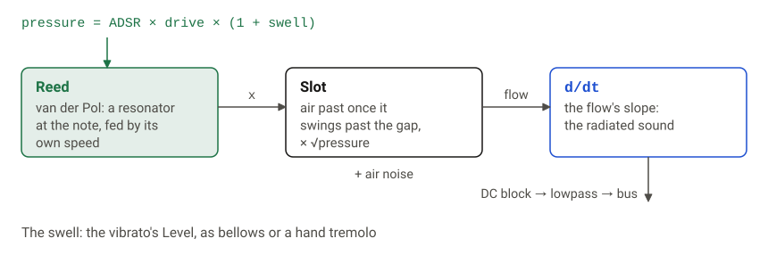
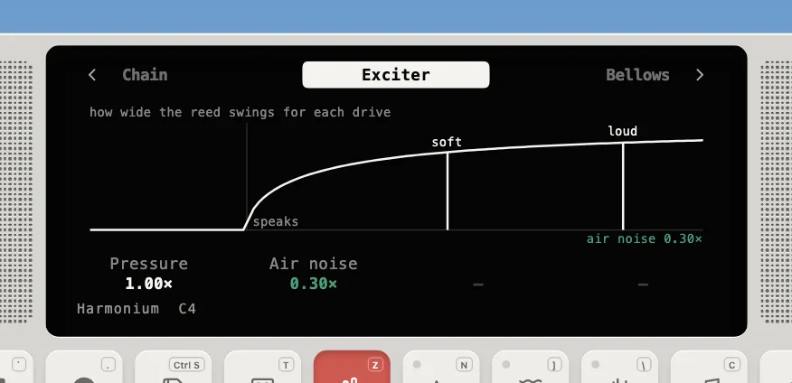
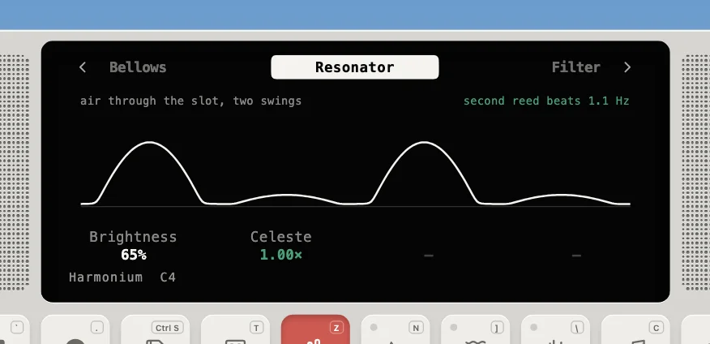

---
order = 6
---

# Free reeds

The harmonium, harmonica and accordion are free reeds (`models/ReedInstrument.ts`). A free reed is a brass tongue that swings through a slot. Each swing it lets a pulse of air past, and that pulsing flow is the sound; unlike the sax's reed, no tube sets the pitch, so the tongue's own frequency does. A key can have several reeds: the harmonium's second sits a few cents sharp and beats against the first, and the accordion's musette has three, one in tune and one either side of it.



```text
   reed:  x'' - (2/t)(D - 1 - 4 D x^2) x' + w^2 x = 0
   flow:  ( opening(x - slot) + (1 - asym) opening(-x - slot) + clearance ) x sqrt(p)
```





- **The reed** is a two-pole resonator tuned to the note whose swing dies away over `settle` seconds, fed by its own velocity in proportion to the drive `D`. Below D = 1 it just rings down; above it the swing grows and settles at an amplitude of `√((D − 1)/D)`, so a harder push swings it wider. The pressure step bends the reed first (`push`), so it speaks in tens of milliseconds rather than growing from nothing.
- **The slot.** Air rushes past once the tongue is more than `slot` from rest (the Brightness param moves it); the opening's corners are rounded so high notes don't alias. `asymmetry` is how much less it opens on the way back: one-sided swings keep the fundamental, symmetric ones would sound the octave. The flow follows the opening and `√pressure` (Bernoulli).
- **The sound** is the flow's slope, as a small source radiates, so the pulses' edges make it bright, and a wider swing brightens it further. Its 6 dB-per-octave rise is mostly taken back so the range sits level.
- **Two reeds a key** (harmonium): the second is a few cents sharp, so the pair beats; the Celeste param scales how far.
- **Polyphonic.** Up to 12 voices (harmonium, accordion) or 6 (harmonica); a measured `tuningCents` table corrects the small detune of the discrete oscillator.
