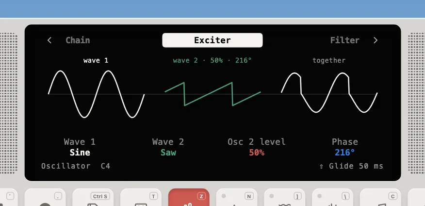

---
order = 8
---

# Oscillator

The one source with nothing to simulate (`models/OscillatorInstrument.ts`, not a physical model): two band-limited waves, each a sine, triangle, square or saw (the **Wave** param, in the vibrato's shape order, without random), the second optional with its own level and phase (off on the Device's Oscillator preset; Starter 1's last track puts a saw at half level 216° behind the sine), summed through the shared [filter](../voices-and-modules.md#modules) and an ADSR, for the modules to shape. It runs on its own bus like any instrument, so it reaches the [master ADSR, LFO and FX](../master-effects.md) the same way.

- Raw square and saw edges alias at high notes, so the square and saw steps are rounded off with **polyBLEP** and the triangle's corners with **polyBLAMP** (`dsp/generators.ts`), about 15 dB less aliasing at F7.
- Each wave is scaled to a sine's RMS, so switching waves keeps the level; one output gain puts a mezzo-forte C4 at −14 LUFS momentary for all four.
- Its Envelope is only a gate's Attack and Release, holding full level while the key is down: decay and sustain come from the master ADSR (the Device's ADSR mode), so two volume envelopes never stack. Up to 8 voices.
- **Glide**: played legato, a new note's frequency slides from the held note's (50 ms by default), under the same chord rule as the [bowed strings](bowed.md).
