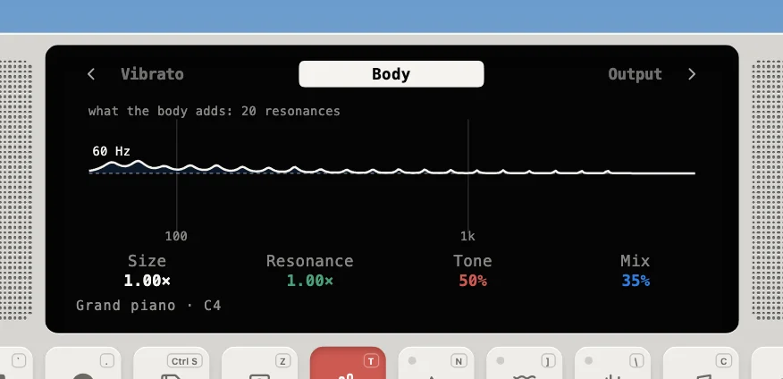

---
order = 1
---

# Physical modeling

The Device doesn't play samples, and apart from one plain [Oscillator](oscillator.md) source it doesn't use oscillators. Every other note is a small physics simulation. An **exciter** (hammer, pick, finger, breath, bow or drum stick) drives a **resonator** (a string, a tube, a reed or a drum head), and the resonator's own feedback loop creates the pitch and tone. A **body** (soundboard, guitar top, bell) then colors the result.

Struck and plucked sounds only excite the string once, at the start. For blown and bowed sounds the exciter stays coupled to the resonator: the air jet and the bow keep reacting to what comes back. That is why the flute, sax and violin can squeak, overblow and slide.

## The families

Each family is a model in `app/lib/physical/models/`:

- [Strings](strings.md): piano, guitars, ukulele, banjo, basses, harp and sitar; struck or plucked string loops.
- [Blown](blown.md): flute, alto sax, clarinet, trumpet, bass trumpet and trombone; a jet, reed or lips on a tube.
- [Bowed](bowed.md): violin and cello; a bow's stick and slip on a string.
- [Drums](drums.md): the Drum, Rock, Jazz, Jazz stick, 808 and 909 kits, madal and tabla; struck membranes and metals as banks of modes.
- [Free reeds](free-reeds.md): harmonium, harmonica and accordion; a tongue swinging through a slot.
- [Tuned percussion](tuned-percussion.md): xylophone, steel pan and kalimba; struck bars, domes and tines.
- [Oscillator](oscillator.md): the one source that isn't a model.

A model renders only its raw signal. The [voice's modules](../voices-and-modules.md), the instrument's body (below), the [master effects](../master-effects.md) and the rest of the [sound pipeline](../sound-pipeline.md) take it from there.

## Bodies (`models/Body.ts`)

| Kind      | How it's built                                                              | Used by                                                                                                                                                                                                |
| --------- | --------------------------------------------------------------------------- | ------------------------------------------------------------------------------------------------------------------------------------------------------------------------------------------------------ |
| modal     | the bus summed to mono through a bank of N modes, mixed into left and right | piano (a 20-mode soundboard, log-spaced 60 Hz–3 kHz, T60 0.25 s → 0.04 s), acoustic and nylon guitar, ukulele, banjo, upright bass, harp, sitar (with the taraf), cello, harmonium, accordion, kalimba |
| radiation | a highpass (with a presence peak) crossfaded in by the mix                  | flute, sax, clarinet, the brass and harmonica: the open end or bell radiates highs better than lows                                                                                                    |
| none      | the bus passes through                                                      | electric guitar and bass (pickup comb and drive instead), violin (its body is in the voice), xylophone, steel pan, the oscillator, the kits                                                            |

Every body ends in an optional ±6 dB tilt around 800 Hz (Tone). The Body page draws what it adds:

A body is driven continuously, not by a single impulse, so each mode's resonant gain is normalized (`amp x 2(1 - r)`). Without that, long-ringing modes would boost the level by tens of dB. **Size** scales the mode frequencies (0.7–1.4×), and **Resonance** scales their decay (0.5–2×).

## The pictures

The pictures of the Device's screen in these docs are its Synth parameters view (the Synth parameters pad), which draws each module's graph from the patch with the engine's own code, so you can open the same page on the Device and turn its knobs to see what they do. They're shot by `scripts/screenshots/` (`npm run screenshots`); the diagrams are SVGs drawn by `scripts/diagrams/` (`npm run diagrams`), each with a `.dark.svg` twin for the dark theme. Both are kept in `public/docs/synth-engine/`.
