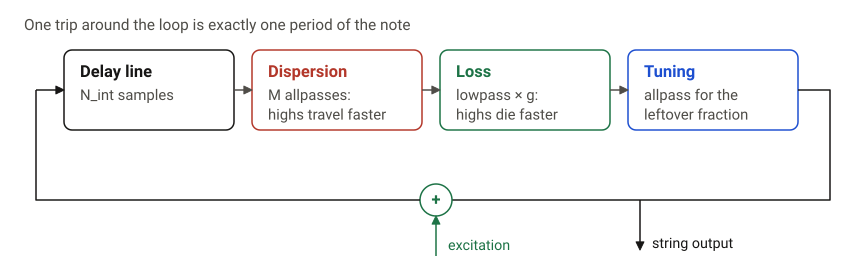
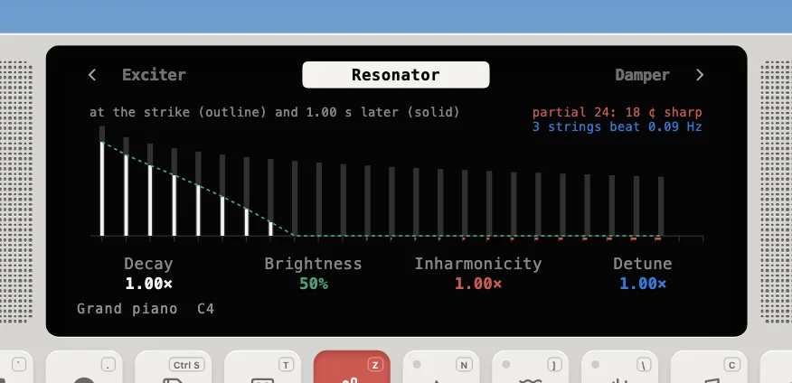
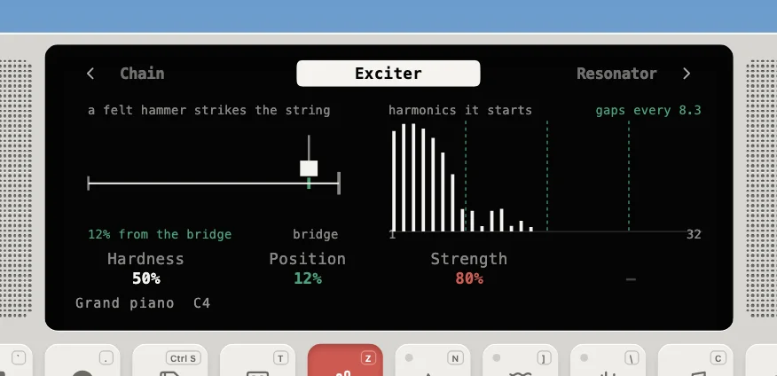
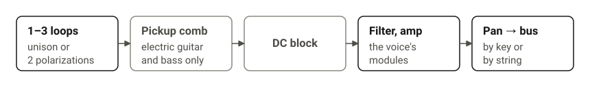
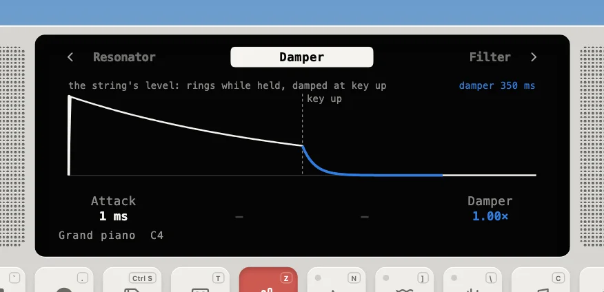
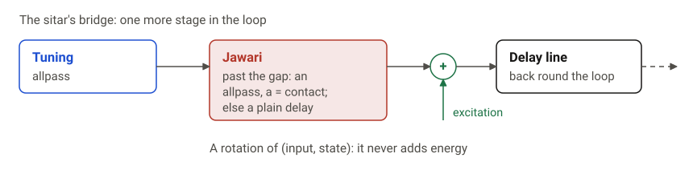

---
order = 2
---

# Strings

The piano, guitars, ukulele, banjo, basses, harp and sitar are struck and plucked strings (`models/StringInstrument.ts`).

## The loop (`models/StringLoop.ts`)

Each string is an extended **Karplus-Strong** loop. A wave travels around a delay line, and each trip through the loop filters it a little:



**Exact tuning.** The pitch is whatever frequency makes the loop exactly one period long. Every filter adds a little delay, so the loop subtracts that delay at the fundamental ω0:

```text
   fs / f0  =  N_int  +  d  +  tau_loss(w0)  +  M * tau_dispersion(w0)
```

`N_int` is the integer delay; `d`, the fraction left in [0.5, 1.5), is realised by an allpass solved for exactly that delay at ω0.

**Exact decay.** The loop gain `g` is chosen so the note loses 60 dB after `f0 * T60` trips around the loop:

```text
   g = 10^(-3 / (f0 * T60)) / |H_loss(w0)|        (capped at 0.99999 so it can never grow)
```

For very high notes with long decays, the loss filter alone would already lose too much per trip. The loop then lightens the filter just enough to keep `g < 1` (`lightestLoss`).

The Resonator page shows that loop's partials, measured from `StringLoop.partials`: at the strike (outline) and a second later (solid), with how far stiffness stretches the high ones sharp and how fast the unison strings beat.



Everything that varies across the keyboard is a **key table**: piecewise-linear values per MIDI note for T60, loss (brightness), dispersion stages and coefficient, damper T60, unison detune and hammer mass. For example, the piano rings 18 s at A0 and 0.5 s at C8, with 8 dispersion stages in the bass and none above C6.

## Exciters (`models/exciters.ts`)

The exciter writes a short burst into a buffer, and the loop adds it in sample by sample.



- **Hammer.** A small physics simulation: a felt hammer (stiffness exponent 2.5) hits a string. Faster hammers and harder felt give a shorter contact, and a shorter contact means a brighter tone. Hammer mass follows the key: heavy in the bass, light in the treble.
- **Pick or finger.** Each plucked string starts on its instrument's usual pluck, and its **Pluck** param switches it: a pick displaces the string into a triangle with the scrape of the pick as noise, a fingertip into a soft raised-cosine bump. A strum plays the same pluck on each string, so the Picked and Fingerstyle Guitar presets strum the same way they pick.
- **Pluck position.** Plucking or striking a string at 1/β of its length silences every β-th harmonic. A comb `e[n] - e[n - b]` removes those harmonics (the pick's triangle already has the notches built in).
- **Velocity** blends between "ignore velocity" and `velocity^curve` through the Strength parameter.

## Voice chain and allocation



|                 | Piano                                                       | Guitar                             | Electric / upright bass                 |
| --------------- | ----------------------------------------------------------- | ---------------------------------- | --------------------------------------- |
| Allocation      | per **key**, 24 voices                                      | per **string**: 6 open strings     | per **string**: 4 open strings          |
| Loops per voice | 1–3 unison strings (detuned, each decaying at its own rate) | 2 polarizations (+0.3 ¢, 0.6× T60) | 1                                       |
| Exciter         | felt hammer                                                 | pick                               | finger                                  |
| Body            | 20-mode soundboard                                          | modal top plate                    | none (pickup comb + drive) / modal body |

- **Per-string allocation.** A note goes to the string that can play it at the lowest fret. If that string is already ringing, the voice damps it for 8 ms, retunes it and plucks it again (a **re-fret**).
- **Re-striking** a key that is still sounding re-excites the same loops, so the old vibration keeps going underneath the new one, as it would on a real string.
- **Dampers.** The Damper page draws the string's level: it rings while the key is held, then falls to the damper's T60 at key up.

  

  A note-off ramps the loop's T60 down to the damper T60 over 15 ms. With the sustain pedal down, the damping waits until the pedal lifts. Piano keys above F6 have no dampers, like a real piano.

- **Strum.** Chord-macro notes arrive as a burst within 15 ms. If the Strum param is set, each note in the burst is delayed a few more milliseconds than the last.
- **Electric guitar and bass** have no acoustic body. A pickup tap subtracts the loop read a few samples away (the comb filter of a magnetic pickup), and the bus drive stands in for the amp. The **nylon guitar** uses the finger exciter, darker loss and less stiffness than steel.
- **Harp.** A string per key, and no dampers anywhere in its range, so every note rings until it fades.
- **Ukulele and banjo.** Both use per-string allocation. The ukulele's four nylon strings are re-entrant (G4 C4 E4 A4, the G above the C), over a small body whose modes sit higher than a guitar's. The banjo's five steel strings are in open G with the short high g drone, picked near the bridge; its body is a tight drumhead, so the modal body holds membrane modes that ring bright and short, and the strings fade sooner than a guitar's.
- **Sitar.** A steel string plucked by a wire mizrab, over a body that holds both the gourd's modes and the **taraf**: eleven sympathetic strings tuned to C major (C4–G5), each a 3 s mode at its fundamental and a 2 s mode at its octave, so they ring along with matching notes and harmonics. The playing string buzzes on its **jawari**, a broad curved bridge, modelled after Pierce & Van Duyne's passive nonlinear filter: one more stage in the loop, a first-order allpass that is a plain one-sample delay at rest and switches to coefficient `contact` (0.6 × the Jawari param) while the string is past the bridge's gap.

  

  In formulas: with `s` the string's displacement, `a = contact` when `s > gap` and `0` otherwise, and `(y, s') = (a x + c s, c x − a s)` with `c = √(1 − a²)`.

  Shortening the loop for part of every swing throws energy into the upper partials, and the louder the string, the more of each swing it spends on the bridge, so the note blooms brighter after the pluck and the buzz fades with it. Written as a rotation of (input, state), the stage never adds energy however it switches, so the loop stays stable. Its rest delay of one sample is taken out of the loop length, so the sitar is in tune by construction like the other strings. The string's loss is kept light and its T60 long, because the buzz only lasts as long as the partials it feeds.
