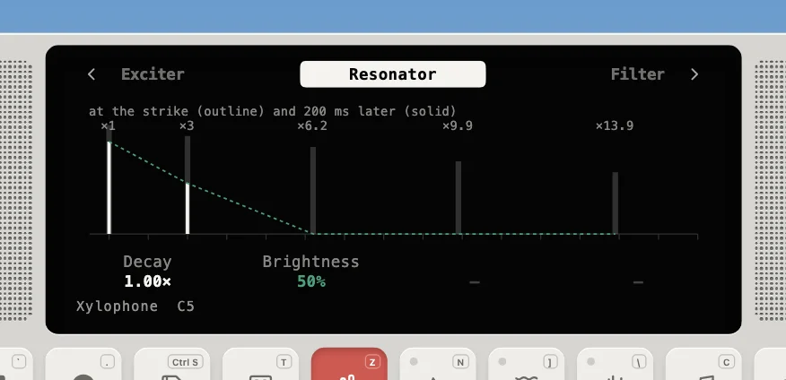

---
order = 7
---

# Tuned percussion

The xylophone, steel pan and kalimba (`models/BarInstrument.ts`) are a struck bar, a hammered pan dome and a plucked tine. They all ring in a handful of modes whose frequencies are fixed multiples of the note, and mostly not whole ones. Each key is a small modal bank:

```text
  strike:  half-sine pulse, length = contact(hardness) x (1 + 0.3 x (0.5 - velocity))
  mode i:  f0 x ratio_i,  level x ratio_i^brightness,  T60 x decay(key) x Decay
  then:    lowpass -> master ADSR -> pan (by key) -> bus
```



|               | Xylophone                                                                       | Steel pan                                                    | Kalimba                         |
| ------------- | ------------------------------------------------------------------------------- | ------------------------------------------------------------ | ------------------------------- |
| Modes (ratio) | 1, 3, 6.2, 9.9, 13.9 (bars undercut to the twelfth; tubes lift the fundamental) | 1, 2, 3, 4.02, 5.05, with twins at 1.004 and 2.006 that beat | 1, 6.27, 17.55 (a clamped tine) |
| Strike        | hard mallet, 1.2–0.25 ms                                                        | rubber-tipped stick, 3–0.8 ms                                | thumb, 4–1.5 ms                 |
| Body          | none                                                                            | none                                                         | a small box (modal)             |

- **The strike** is the [drum kit](drums.md)'s half-sine stick pulse, area-normalized, so the low modes keep their level and a shorter contact (a harder mallet, a harder hit) only adds the highs.
- **Exact tuning.** Every mode is a resonator at its own frequency, so nothing needs a tuning table. Modes above 0.45·fs are left silent.
- **No dampers.** A note rings until it fades; striking it again while it rings adds to what is sounding, as on the real thing.
