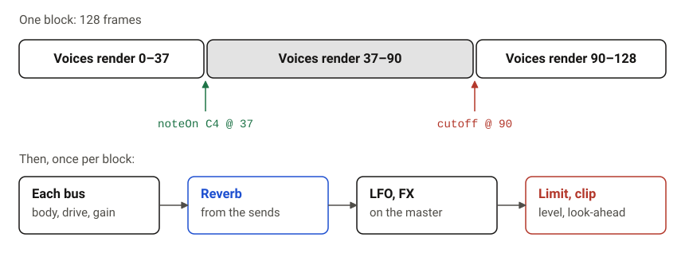
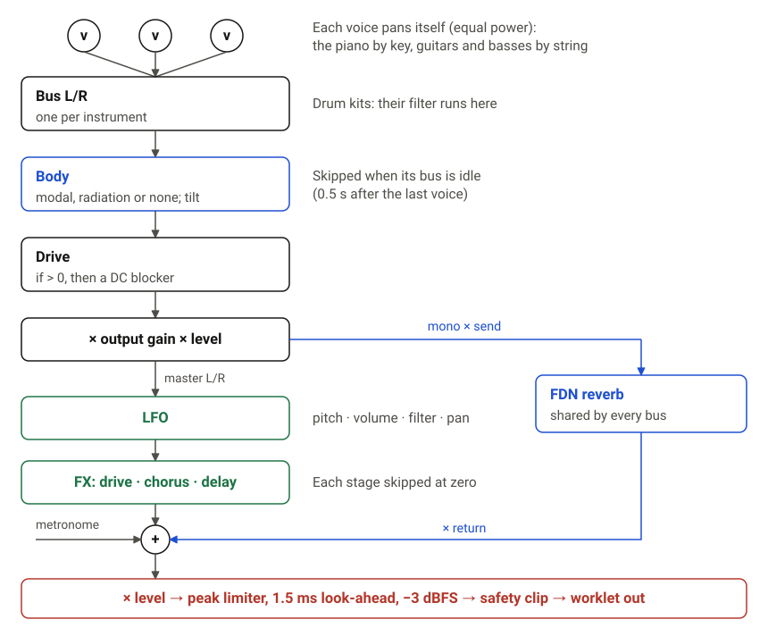
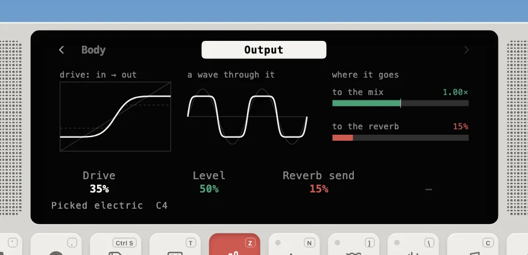

---
order = 1
---

# Sound pipeline

How a note gets from a key press to the speakers: the audio thread the engine runs on, its render loop, and the signal flow from each voice to the output. What each voice models is in [Physical modeling](physical-modeling/overview.md). All the code lives in `web-react/app/lib/physical/`.

- [Voices and modules](voices-and-modules.md): the voice lifecycle, and the filter and vibrato every voice carries.
- [Master effects](master-effects.md): the ADSR, LFO and FX over every instrument.
- [Parameters and calibration](parameters-and-calibration.md): the params, tuning and loudness, the checks, and adding a patch or a Device preset.

## The audio thread

The audio is computed on the browser's audio thread, inside one `AudioWorkletProcessor`. The UI only sends small messages.

- **Lazy boot.** `physicalSynth.start()` runs on the first user gesture (browsers need that to allow audio). It creates the `AudioContext`, loads `processor.worklet.ts` and waits for a `ready` message. Nothing touches Web Audio at import time, so prerendering the page is safe.
- **Nothing is lost while booting.** Events sent before `ready` are queued and replayed immediately, so the very first key press still sounds, just late. For `param` events only the latest value per target/id is kept.
- **Timing.** Events carry an optional `time` in AudioContext seconds. With no time, they play at the start of the next block (at most ~2.7 ms at 48 kHz).
- **API.** `physicalSynth` (from `web-react/app/lib/physical`): `start()` from a user gesture, `noteOn`/`noteOff` (reference-counted per note), `hit`, `setSustain`, `metronomeTick`, `setParam`, `allNotesOff`, `getAnalyser`, `onStats`, `render` (events offline through the worklet) and `scrubber` (plays a rendered buffer at a drag's speed, tape-style). Events sent before the worklet is ready are queued.

## The render loop

`Engine.render()` never allocates memory: every buffer, voice and delay line is preallocated. Events are applied at their **exact sample**, because the block is cut into segments at each event:

`EventQueue` is a preallocated array kept sorted by frame. Events at the same frame keep their arrival order, so a chord's notes and a param change sent together land in order.

## Signal flow

Each instrument owns one **bus**. Its voices add their panned output into the bus buffers, and the bus stage then finishes the sound:

- **Output.** The Output page draws the bus's drive curve, a wave through it, and how much goes to the mix and to the reverb.

  

- **Idle buses cost nothing.** After its last voice ends, a bus keeps running for 0.5 s so the body can ring out, then it is skipped entirely.
- **Master effects.** Every voice goes through the master ADSR, and the dry mix through the master LFO and FX before the reverb return is added: see [Master effects](master-effects.md).
- **No zipper noise.** Gain, send, drive, volume, reverb return and the LFO and FX amounts glide through `Smoother`s (~10 ms one-pole).
- **Why two limiters?** A chord's hammers or plucks land on the same sample, so their transients stack almost fully: a piano triad at the default level peaks about 6 dB over −3 dBFS. Those sub-millisecond peaks are too fast for the browser's compressor. The engine's look-ahead limiter (`dsp/PeakLimiter.ts`) sees each peak 1.5 ms early and ramps the gain down to meet it, so the chord is turned down for a moment instead of squashed; below the ceiling it only delays. It delays everything by those 1.5 ms. The tanh clipper behind it only catches what rounding lets through, and the browser's compressor still guards the track mixer and scrubber, which sum rendered buffers outside the engine.
- **Level and volume.** The master level (`master.volume`) is applied before the limiter, so it sets how hard chords push into it. The Device's white knob is a system volume after the browser limiter and analyser, so turning it up never clips.

## Reverb (`dsp/Fdn.ts`)

One shared 8-line **feedback delay network**. Each instrument feeds it through its own Reverb send.

- Every line loses exactly 60 dB in the Reverb decay time, whatever its length.
- The Householder matrix mixes every line into every other one at O(N) cost, so echoes smear into a dense tail.
- **Sleep.** After 0.5 s below −100 dBFS the reverb clears itself and stops computing, and it wakes on the next input.

## From key press to sound

