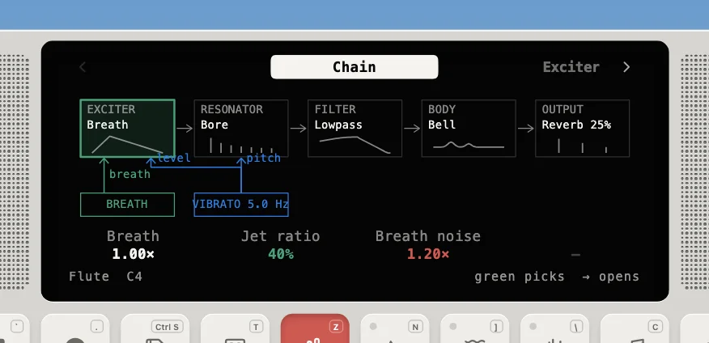
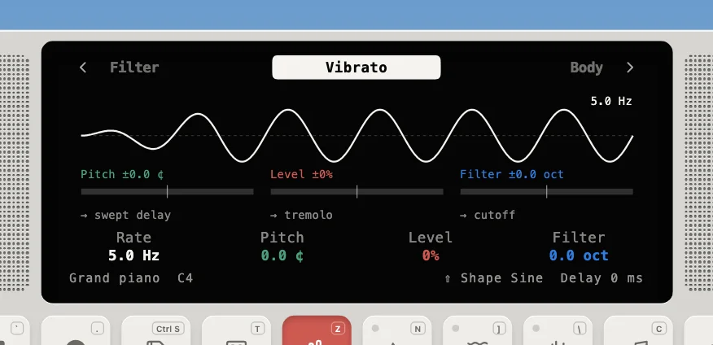
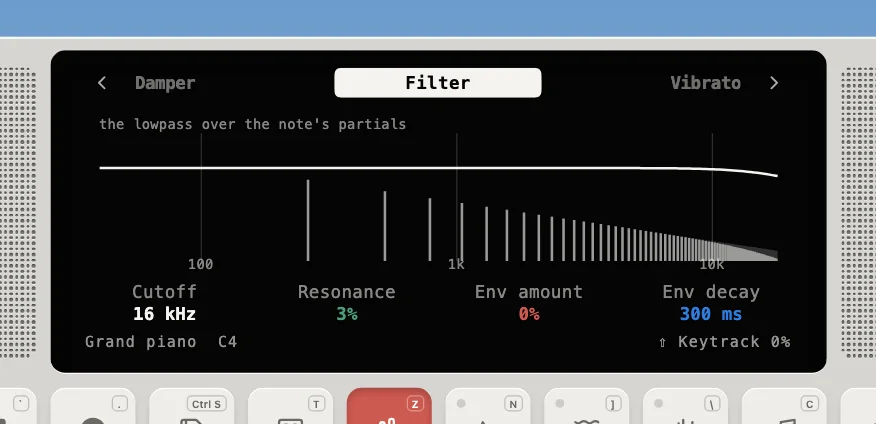

---
order = 2
---

# Voices and modules

## Lifecycle

A voice is one sounding note (or one string, or one drum piece). Every model shares the same state machine from `engine/Voice.ts`:

When all voices are busy, `pickVictim` chooses which one to reuse: the **quietest released** voice first, otherwise the **oldest active** one. Voice pools hold a few spares above the polyphony so a stolen voice can fade out while its replacement starts.

## Modules

Inside each instrument, every voice carries the same **filter** and **vibrato** (an LFO of its own), set from the same params on every melodic instrument (`engine/Modules.ts`, `ModuleSettings`), alongside the model's own **envelope** (the breath, the bow, the bellows; a string's attack and damper; the oscillator's gate). These belong to the instrument. The **master ADSR** and **master LFO** are the engine's ([Master effects](master-effects.md)): the Device sets them over every instrument (its ADSR and LFO modes, kept per track), with their own params (`adsr.*`, `lfo.*`) apart from any instrument's. A model renders only its raw signal and hands each sample to its voice's chain (`engine/VoiceChain.ts`), which runs the rest of the voice the same way for all of them. In the order a note goes through:

The Synth screen's **Chain** page draws the same thing for the instrument you're playing, with its envelope and vibrato wired to where they act. On the flute, the breath drives the exciter, and the vibrato moves the breath (Level) and the bore (Pitch):

The **vibrato** (`dsp/generators.ts`, `Lfo`) is one per voice: Rate, Shape (sine, triangle, square, saw, random), and a Delay after which its depth fades in, the way a player starts vibrato late. Three depths say where it goes. Filter always sweeps the filter's cutoff, by octaves. Pitch and Level go to whatever the model has that is physical to move, and otherwise to the voice's output right after the filter:

| Depth | Winds (`BoreInstrument`) | Bowed strings     | Free reeds                   | Oscillator      | Strings, bars       |
| ----- | ------------------------ | ----------------- | ---------------------------- | --------------- | ------------------- |
| Pitch | the bore's length        | the neck's length | output: swept delay          | the oscillators | output: swept delay |
| Level | breath pressure          | bow velocity      | bellows pressure (the swell) | output: tremolo | output: tremolo     |

The **filter** is the same state-variable lowpass on every voice. Its page draws its response over the note's partials:

- **The swept delay** bends any model's output, however it is built: a delay moving at speed `v` shifts pitch by `1 − v`, so a swing of `p` needs a sweep of `p / (2π · rate)` s. It is capped at 8 ms, which only limits the slowest rates, and crossfades in and out over 20 ms so switching it never clicks.
- **The free reeds' vibrato runs freely**: every voice joins one cycle that started with the instrument, as a harmonium's bellows move every reed at once. Everywhere else each note starts its own after the Delay.
- **Drum kits** have no envelope or vibrato, and filter the whole bus instead of each voice.
- **Restarts.** A new note snaps the filter to its cutoff and starts the envelope and vibrato over. A re-strike while the note rings (a piano key, a bar) restarts only the filter envelope; a legato wind note keeps both, and its filter glides to the new note's keytracked cutoff.
