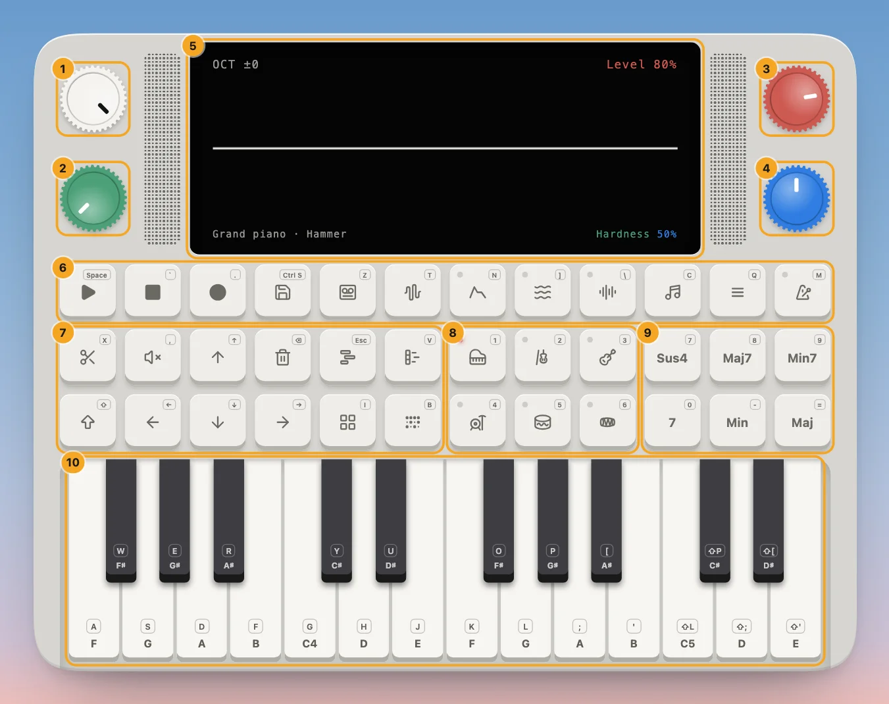

---
order = 1
---

# The Device

The home page (`app/routes/home.tsx`) is **The Device**: an all-in-one virtual synthesizer, a compact music box with four knobs, a screen, 36 pads and a keybed, that holds a whole studio: a physically modelled sound engine (see [Physical modeling](../synth/physical-modeling/overview.md)), a chord machine, a drum machine, a piano roll, and tapes of tracks to keep your songs on.

This section is the reference: where everything is and what it does in each view. To learn it by making a song, start with the [Guides](../guides/introduction.md).

1. **White knob**: the volume.
2. **Green knob**: picks: the setting to change, the position in a list, a tape.
3. **Red knob**: the synth's level, or a list's page.
4. **Blue knob**: sets the picked setting, or picks in a list.
5. **Screen**: what the current view shows.
6. **Top row**: transport, Save, and the views: tapes, synth parameters, ADSR, LFO, FX, chords, play style, tempo.
7. **Left block**: editing (clip, mute, delete), the octave and arrows, Shift, and the tracks, piano roll, instruments and drum grid.
8. **Instrument pads**: six sounds, six more with Shift.
9. **Chord pads**: six chords to play from a single key.
10. **Keybed**: two octaves from F3 to E5, played with the mouse or the computer keyboard.

The Device has a fixed size, scaled to fit the window, and a light and a dark finish (the moon button at the top right of the page). Every control has a keyboard shortcut, printed on its corner.

- [Knobs](#knobs), below: what each knob does in each kind of view.
- [Screen and views](screen-and-views.md): how every view lays out the screen, and every view with what opens it.
- [Pads and keybed](pads-and-keybed.md): all 36 pads, their keys and their Shift jobs, and the keys and their letters.

## Knobs

The knobs keep their colours everywhere: whatever a view draws in green, the green knob sets.

| Knob  | Main screen                               | Lists (instruments, chords, progressions, beats, play styles) | Pages (synth parameters, ADSR, LFO, FX) | Tracks                    |
| ----- | ----------------------------------------- | ------------------------------------------------------------- | --------------------------------------- | ------------------------- |
| White | volume                                    | volume                                                        | the first value                         | volume                    |
| Green | picks which setting the blue knob changes | (a play style's rate or strum)                                | the second value                        | moves through the tape    |
| Red   | the synth's level into the mix            | turns the pages                                               | the third value                         | the picked track's volume |
| Blue  | changes the picked setting                | picks on the page                                             | the fourth value                        | picks a track             |

With Shift held, some views give the knobs a second job, named in the screen's footer: the tracks zoom and scroll, or trim a clip; the synth pages reach their extra settings.

Drag a knob up or down, or scroll over it. Turning the white knob shows the volume over the screen for a moment.
