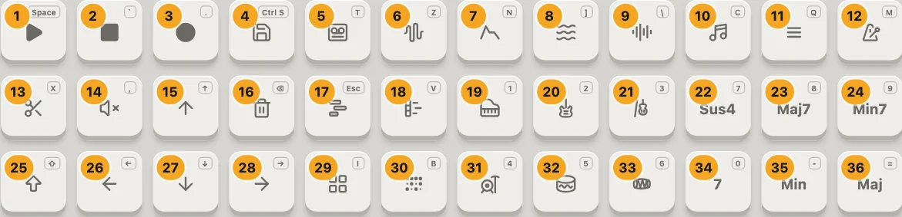
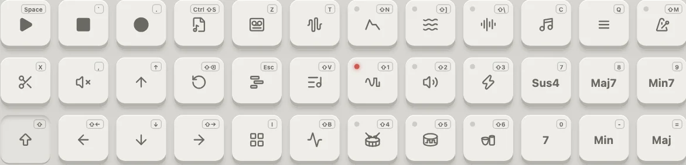
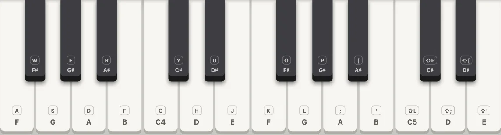

---
order = 3
---

# Pads and keybed

## Pads

Three rows of twelve. The number is the pad's place below; the badge on the pad itself is its key. Hover a pad to see what pressing it does in the view showing.

| #     | Pad                 | Key         | Press                                                                                                                | With Shift                        |
| ----- | ------------------- | ----------- | -------------------------------------------------------------------------------------------------------------------- | --------------------------------- |
| 1     | Play                | Space       | plays or pauses what the view plays: the take, the drum grid, the tracks, a preview                                  |                                   |
| 2     | Stop                | `` ` ``     | stops and rewinds                                                                                                    |                                   |
| 3     | Record              | `.`         | arms the take (or the drum grid); Play then records                                                                  |                                   |
| 4     | Save                | Ctrl S      | keeps what the view holds: a sound, a take or pattern as a track, a progression or beat, a new tape, the mix as FLAC | saves the tracks as MIDI          |
| 5     | Tapes               | `T`         | the tapes, a song's tracks on each                                                                                   |                                   |
| 6     | Synth parameters    | `Z`         | the sound's chain and its pages                                                                                      |                                   |
| 7     | ADSR                | `N`         | the volume envelope                                                                                                  | switches it on or off             |
| 8     | LFO                 | `]`         | the modulator over the mix                                                                                           | switches it on or off             |
| 9     | FX                  | `\`         | drive, chorus, delay and reverb                                                                                      | switches it on or off             |
| 10    | Chords              | `C`         | sets what the chord pads play                                                                                        |                                   |
| 11    | Play style          | `Q`         | how chords come out: block, strum, arpeggio, rhythms                                                                 |                                   |
| 12    | Tempo               | `M`         | the tempo, tap tempo and the time signature                                                                          | starts or stops the metronome     |
| 13    | Clip                | `X`         | in the tracks, loops the picked track's clip                                                                         | trims the track to its clip       |
| 14    | Mute                | `,`         | in the tracks, mutes the picked track                                                                                | solos it                          |
| 15    | ↑                   | ↑           | an octave up (in the tracks, the track above)                                                                        |                                   |
| 16    | Delete              | Backspace   | deletes what the view has picked, on a second press                                                                  | Revert                            |
| 17    | Tracks              | Esc         | the open tape's tracks                                                                                               |                                   |
| 18    | Piano roll          | `V`         | the take, as a piano roll                                                                                            | chord progressions                |
| 19–21 | Instrument pads 1–3 | `1`–`3`     | Grand piano, Violin, Picked guitar                                                                                   | Oscillator, Alto sax, Bass guitar |
| 22–24 | Chord pads 1–3      | `7`–`9`     | Sus4, Maj7, Min7                                                                                                     |                                   |
| 25    | Shift               | Shift       | held, the second jobs; clicked, latches until the next press                                                         |                                   |
| 26    | ←                   | ←           | an octave down, or the previous page                                                                                 | the previous instrument           |
| 27    | ↓                   | ↓           | an octave down (in the tracks, the track below)                                                                      |                                   |
| 28    | →                   | →           | an octave up, or the next page                                                                                       | the next instrument               |
| 29    | Instruments         | `I`         | the library of every sound                                                                                           |                                   |
| 30    | Drum grid           | `B`         | the step sequencer for the kits                                                                                      | drum beats                        |
| 31–33 | Instrument pads 4–6 | `4`–`6`     | Rock kit, 808 kit, Madal                                                                                             | Jazz kit, 909 kit, Tabla          |
| 34–36 | Chord pads 4–6      | `0` `-` `=` | 7, Min, Maj                                                                                                          |                                   |

Pads that open a view light up while it's open, and press again to close it. A small dot on a pad is a status light: ADSR, LFO and FX while they're on, the metronome while it clicks, the instrument pad playing now. In a picker, the pads that take its pick change job: an instrument pad pressed twice binds the sound in Instruments, a chord pad pressed twice takes the chord in Chords.

Hold Shift and the pads show their second jobs, each marked with ⇧:

## Keybed

Two octaves, F3 to E5, moved by the octave keys. On a computer keyboard the home row plays the white keys (`A S D F G H J K L ; '`, with `G` on C4) and the row above the black ones (`W E R`, `Y U`, `O P [`). With Shift, the last five keys carry on past B4 to E5. A latched chord pad turns every key into that chord; with a drum kit, each key is a drum (the key's label shows which).
