---
order = 2
---

# Screen and views

Every pad that opens something opens a **view**: the same knobs, pads and keys, given new jobs. The one underneath them all is the main screen.

## Layout

Every view lays the screen out the same way.

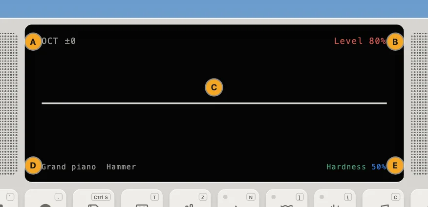

- **A, the status line's left**: the title or, on the main screen, the octave.
- **B, the status line's right**: a count or setting, in the colour of the knob that sets it.
- **C, the body**: the wave, a list of tiles, a page's graph, the roll, the drum grid or the tracks.
- **D, the footer's left**: what's picked, and messages: `Saved Grand piano`, `Press again to delete`.
- **E, the footer's right**: a hint, or what the knobs do now.

In a list, the status line is a **pager**: the page you're on in the middle, the ones either side, turned by the red knob or ← →. The tile picked by the blue knob is highlighted, and a badge marks a sound bound to an instrument pad (`1`, `⇧3`).

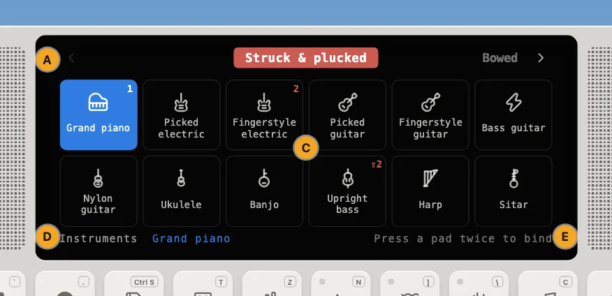

A title with a dot, `Grand piano •`, has unsaved changes. Prompts (`Play the home note`) and levels appear over the middle.

## Views

### Main screen

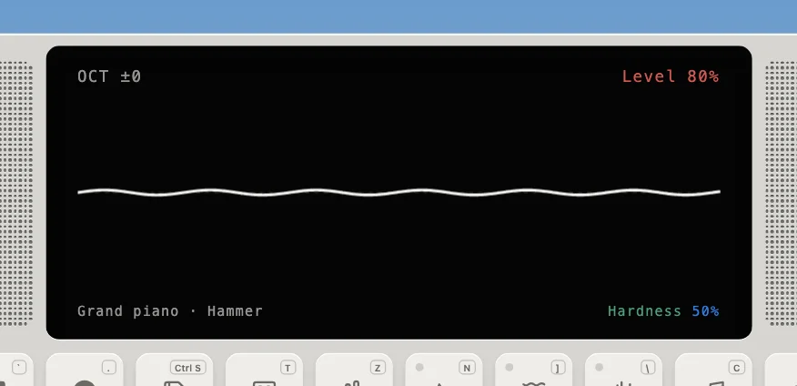

**Opened by:** nothing; it's there whenever no other view is open. The wave of what's playing; green picks a setting, blue changes it, red sets the level.

### Instruments

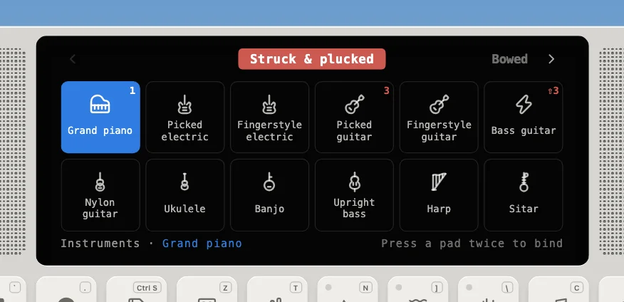

**Opened by:** Instruments. Red turns the families, blue picks; an instrument pad twice binds the sound; Delete removes a saved one.

### Synth parameters

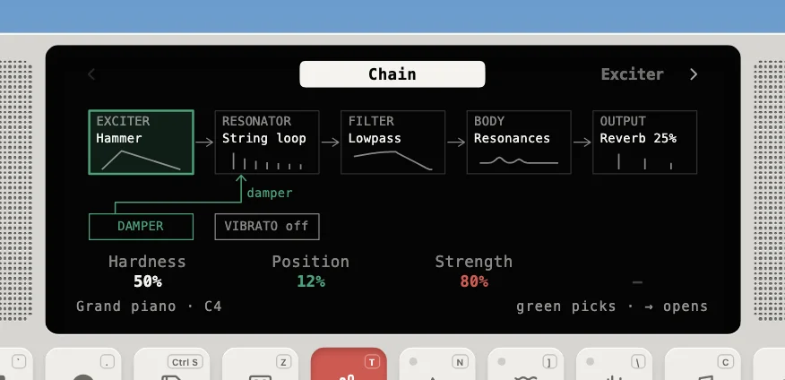

**Opened by:** Synth parameters. ← → turn the pages; the knobs set the page's four values; Shift its extras; Save opens the icon picker.

### Save

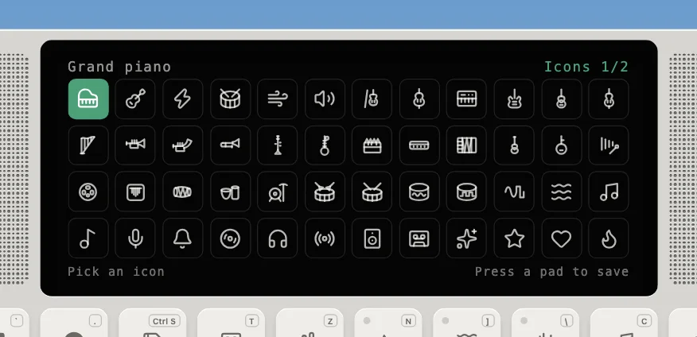

**Opened by:** Save, from the synth parameters. Green picks an icon; Save keeps the sound, or an instrument pad saves it there.

### ADSR, LFO and FX

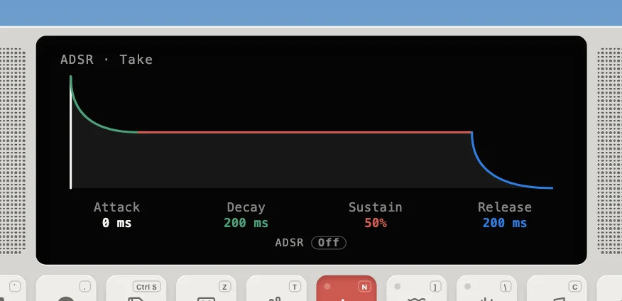

**Opened by:** ADSR, LFO or FX. The knobs set its four values and switch it on; the badge shows on or off.

### Chords

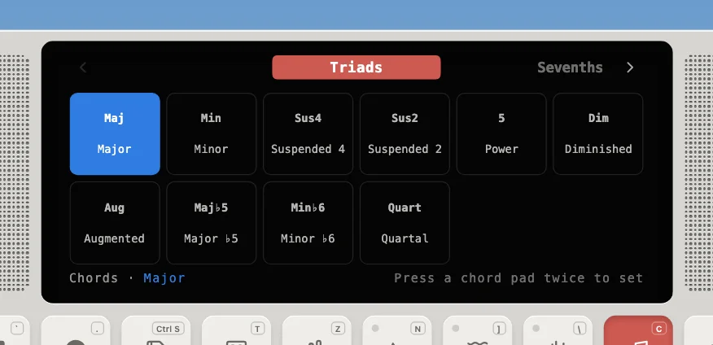

**Opened by:** Chords. Red turns the kinds, blue picks; a chord pad twice takes the chord.

### Play style

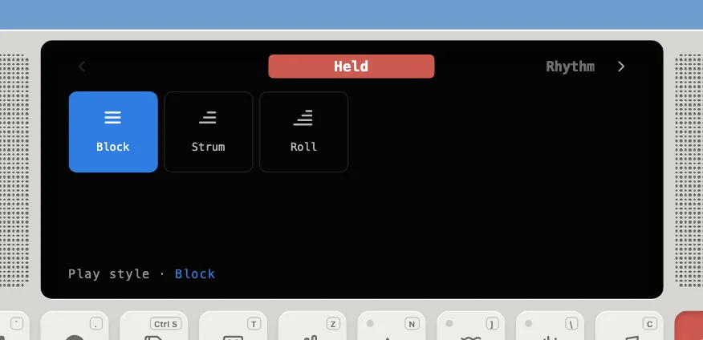

**Opened by:** Play style. Red turns the groups, blue picks; green sets the rate or strum; Save keeps it as a new style.

### Tempo

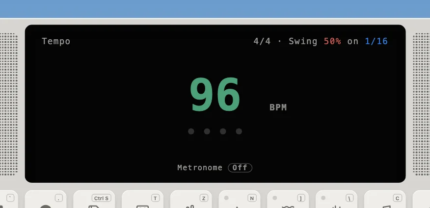

**Opened by:** Tempo. Green and ← → set the BPM (or drag or type the number); ↓ taps it in.

### Progressions

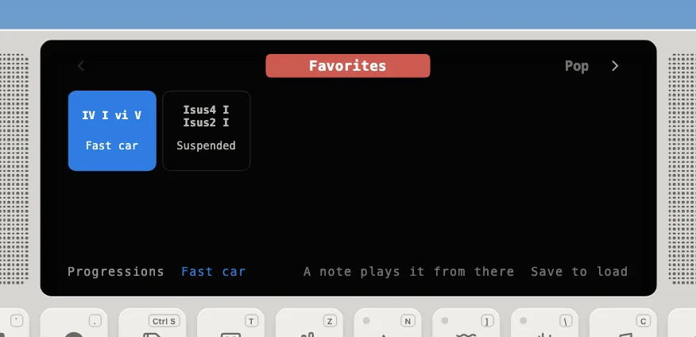

**Opened by:** Shift + Piano roll. Red turns the kinds, blue picks; a tap or Play previews; Save, then a key, loads it as the take.

### Beats

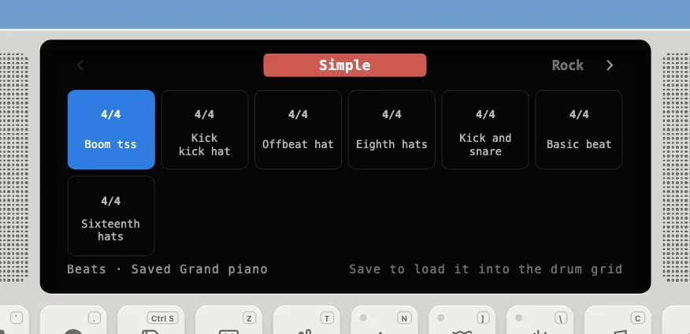

**Opened by:** Shift + Drum grid. Red turns the styles, blue picks; a tap or Play previews; Save loads it into the drum grid.

### Piano roll

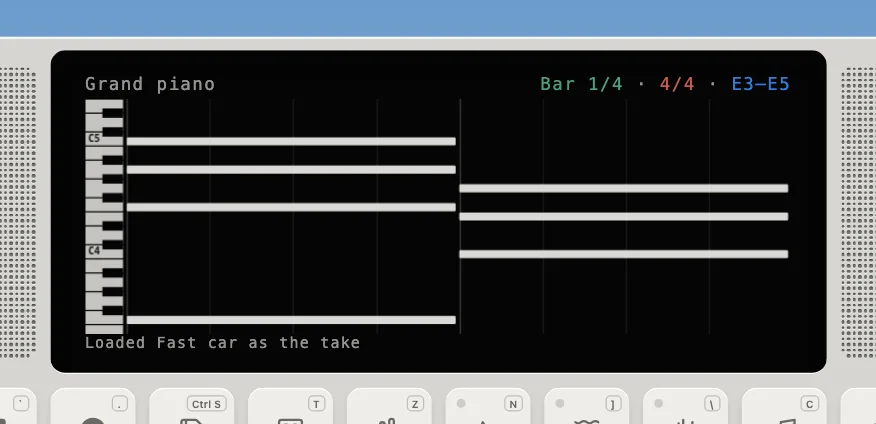

**Opened by:** Piano roll, or Record. The take: Record arms, Play records; green scrolls, red sets the time signature, blue the octave; Save keeps it as a track.

### Drum grid

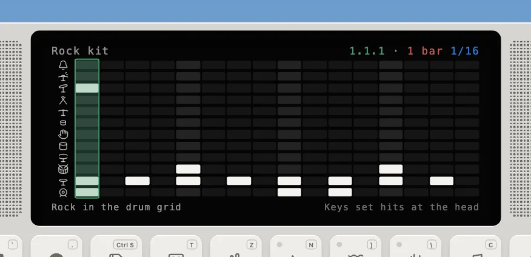

**Opened by:** Drum grid. Green moves the head, keys set hits there; red sets the length, blue the resolution; Save keeps it as a track.

### Tracks

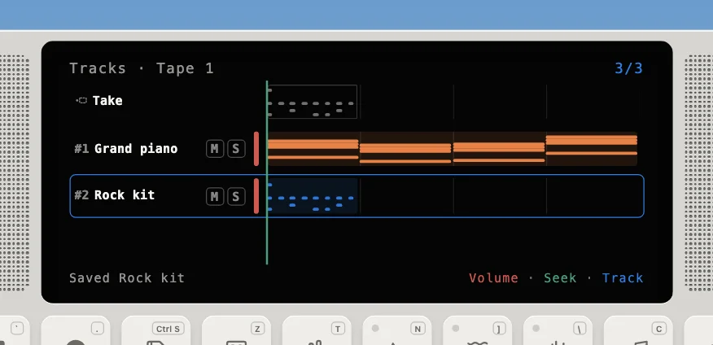

**Opened by:** Tracks. See [the knob table](overview.md#knobs); ← → slide a track, Shift + ← → repeat it, Shift + ↓ picks the next copy of the whole track further along (past the last, adds one: ×2, ×3 on the row's right edge) and Shift + ↑ the one before; Mute, Clip, Delete; Save the mix.

### Tapes

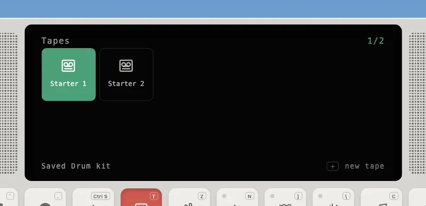

**Opened by:** Tapes. Green and ← → open a tape; Save starts a new one; Delete removes it.

### Revert

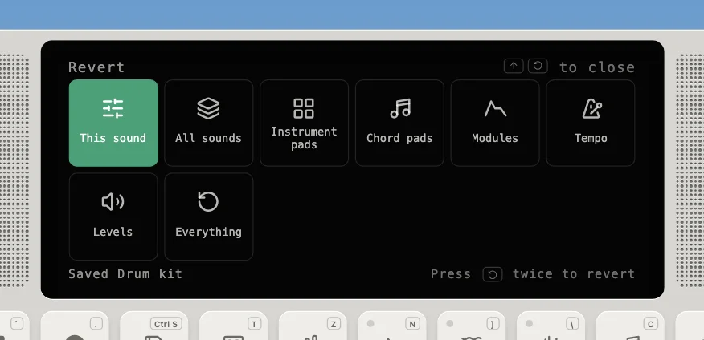

**Opened by:** Shift + Delete. Green picks what to put back; Delete twice reverts it; any other pad closes.
