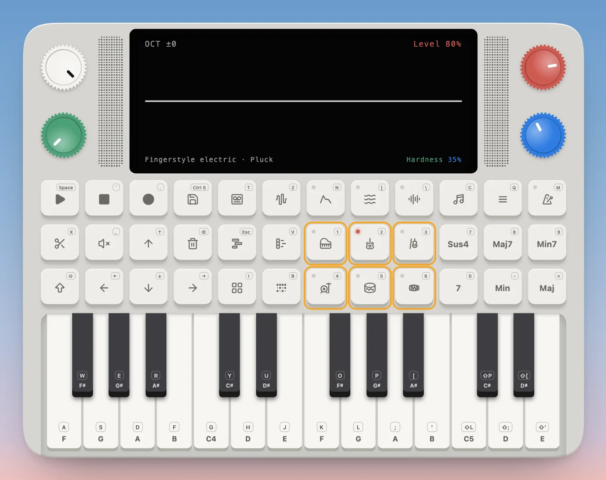
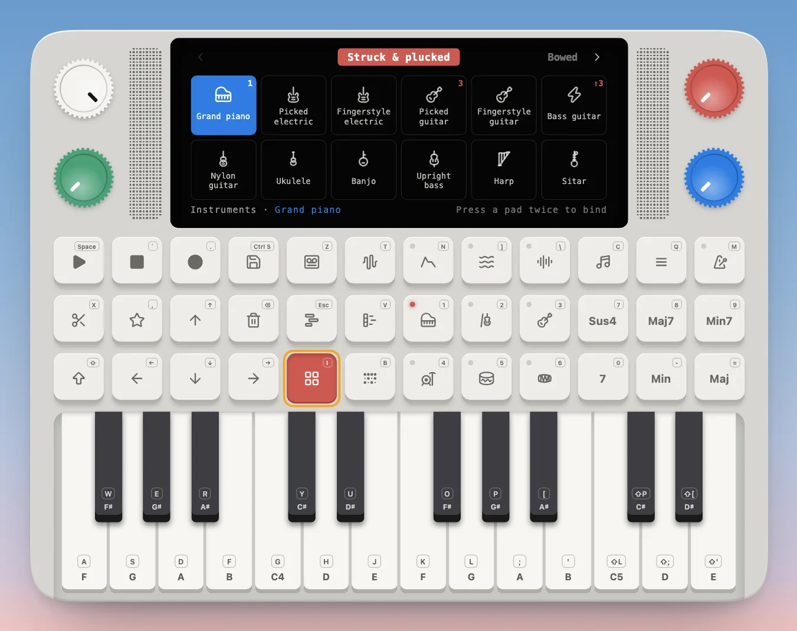
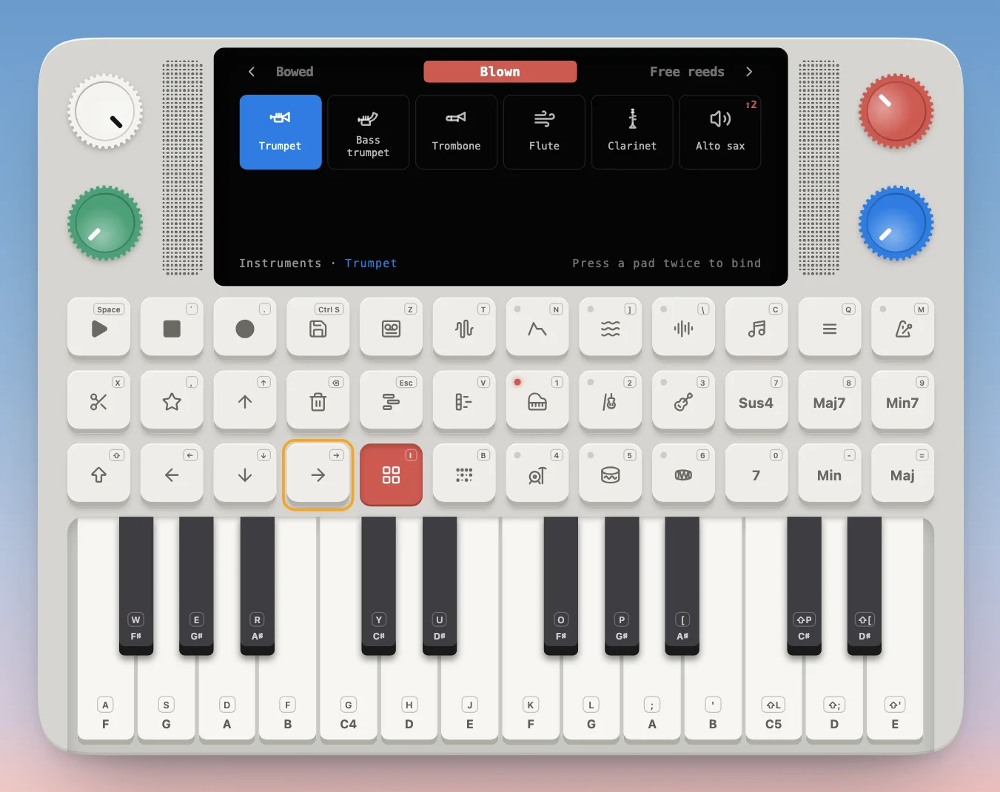
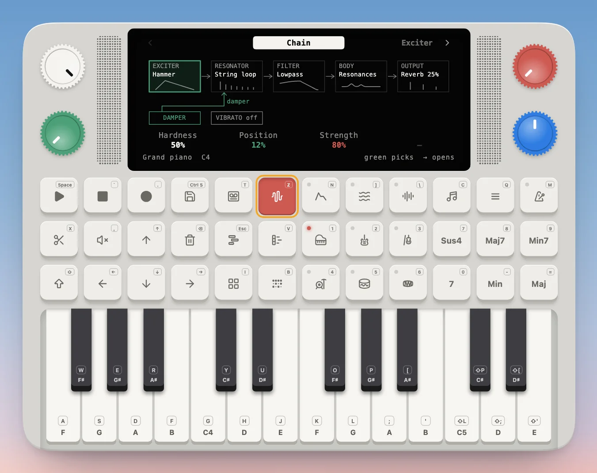
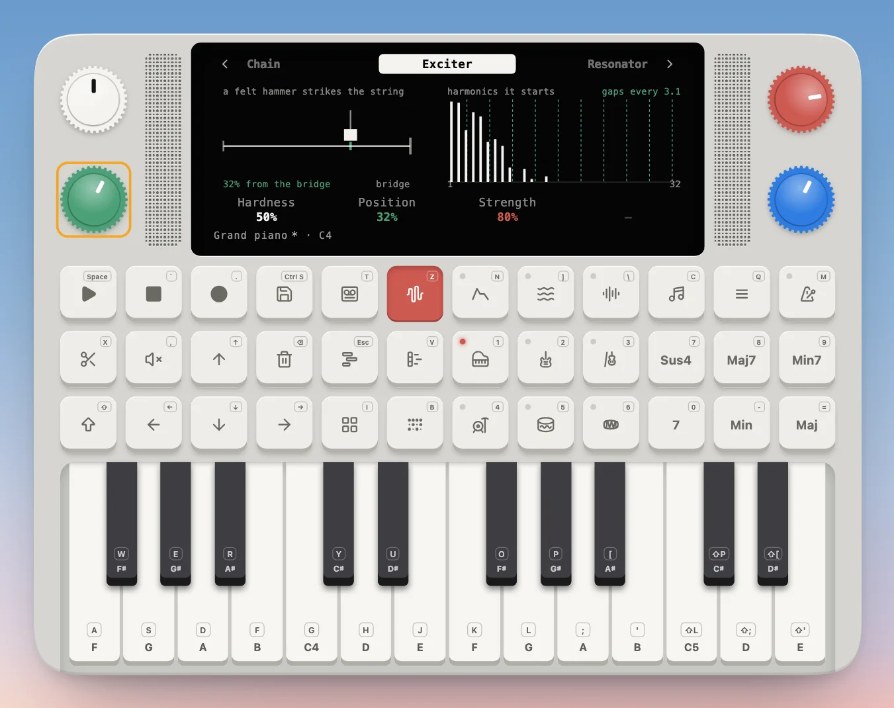
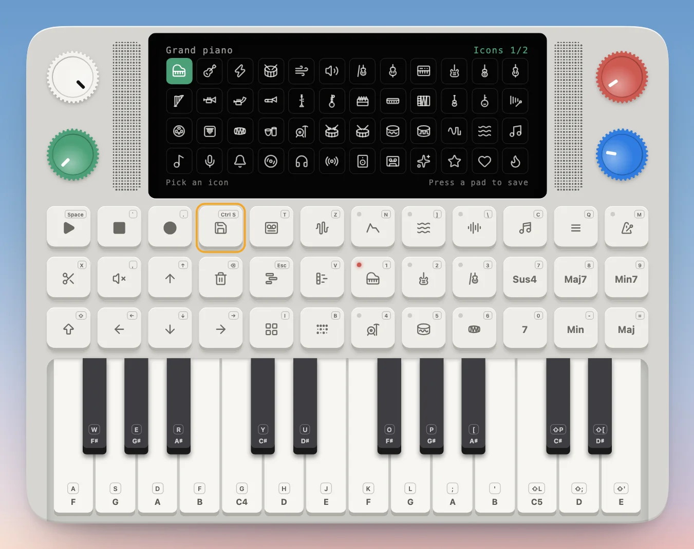
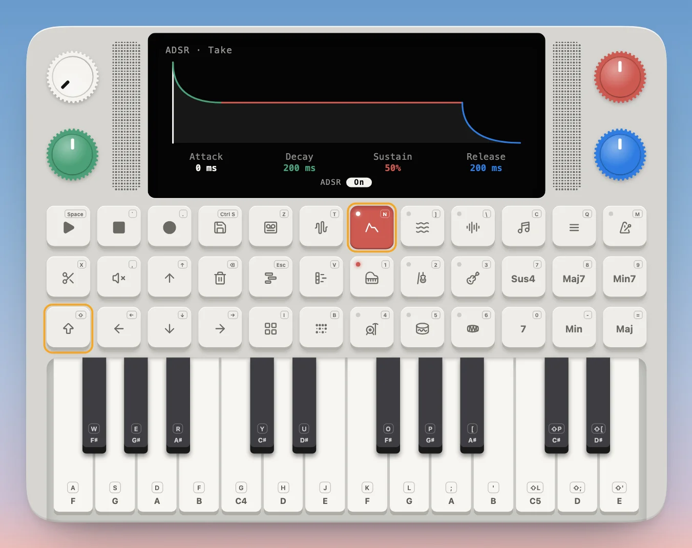
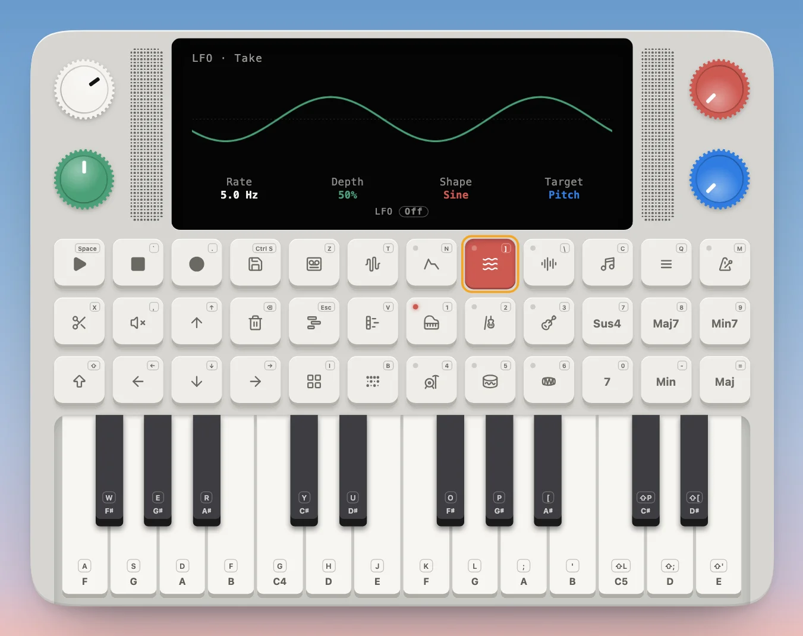
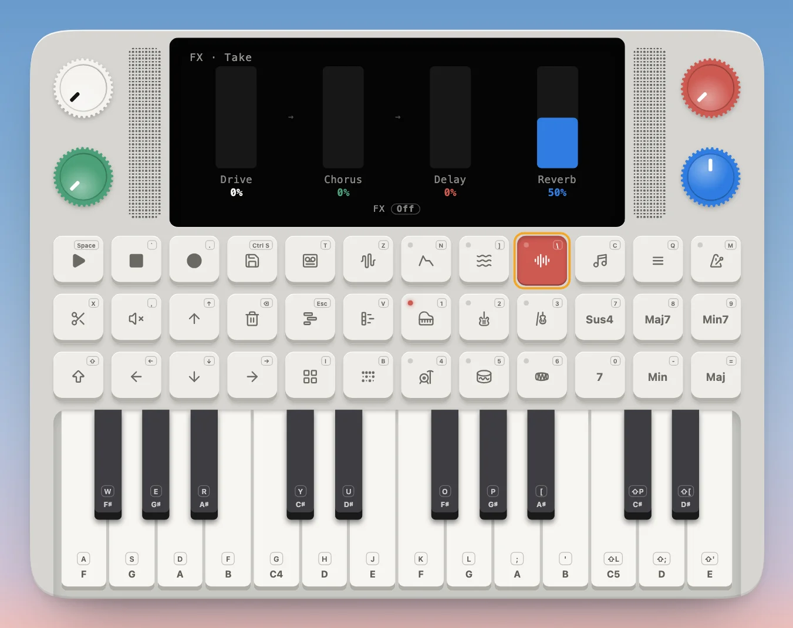

---
order = 3
---

# Shape the sound

Pick an instrument, open it up to change how it's made, and shape everything you play with the master effects.

## Pick an instrument

The six pads with a red dot are your **instrument pads**: Grand piano, Violin and Picked guitar on top, and the Rock kit, 808 kit and Madal below. Press one (or `1`–`6`) to switch, and the dot lights on the one playing. Hold Shift for six more: Oscillator, Alto sax, Bass guitar, Jazz kit, 909 kit and Tabla.

For everything else, open **Instruments** (the four-squares pad, `I`). It's a library of every sound, one page per family: struck and plucked strings, bowed, blown, free reeds, tuned percussion, drums and the oscillator, with your own saved sounds last.

- The **red knob**, or ← and →, turns the pages; the **blue knob**, or a tap, picks a sound to try.
- To keep one at hand, press an instrument pad **twice**: the sound is bound to that pad and the library closes. Pads hold your own saved sounds the same way.
- Press Instruments again to close it. Shift + ← or → also steps through the instruments from anywhere.

## Change how it's made

Every instrument is a small physical model, with parts you can play with. Open **Synth parameters** (the waveform pad, `T`). The first page, **Chain**, draws how the sound is made, left to right: what sets it moving (the exciter: a hammer, a pick, a bow, breath), what rings (the resonator: a string, a tube, a reed), the filter, the body and the output.

← and → step through one page per part. Each page draws what its knobs do, and the four knobs set the four values under it, in their colours.

Turn the green knob here and the hammer moves along the string: the drawing follows, and so does the sound. Other pages work the same way: brighten the string on the Resonator page, close the filter, add vibrato, dry out the reverb on Output. Hold Shift for a page's extra settings, named in its footer. A dot after the name, `Grand piano •`, means the sound has changes you haven't saved.

**Save your sound.** Press Save (`Ctrl S`) from the synth parameters. Pick an icon with the green knob, then press Save again to keep it in the library, or press an instrument pad to save it onto that pad.

## Master effects: ADSR, LFO and FX

Three pads in the top row shape everything you play, whatever the instrument:

- **ADSR** (`N`): a volume envelope over every note: Attack, Decay, Sustain and Release.
- **LFO** (`]`): a slow wobble over the whole mix, on pitch, volume, the filter or the pan.
- **FX** (`\`): Drive, Chorus and a ping-pong Delay in series, and the Reverb level.

Press a pad to open its page; the four knobs set its four values. Turning a knob switches it on. **Shift + the pad** switches it on or off without opening it, and its little dot lights while it's on.

The take and every track keep their own ADSR, LFO and FX, so a track sounds the way it did when you saved it.
